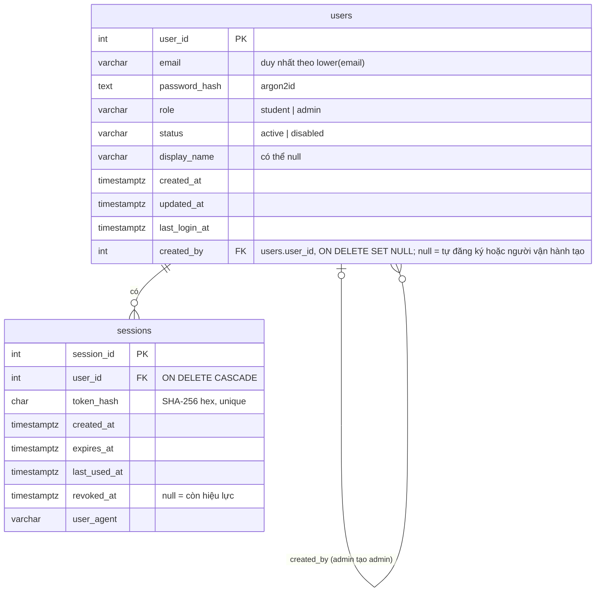
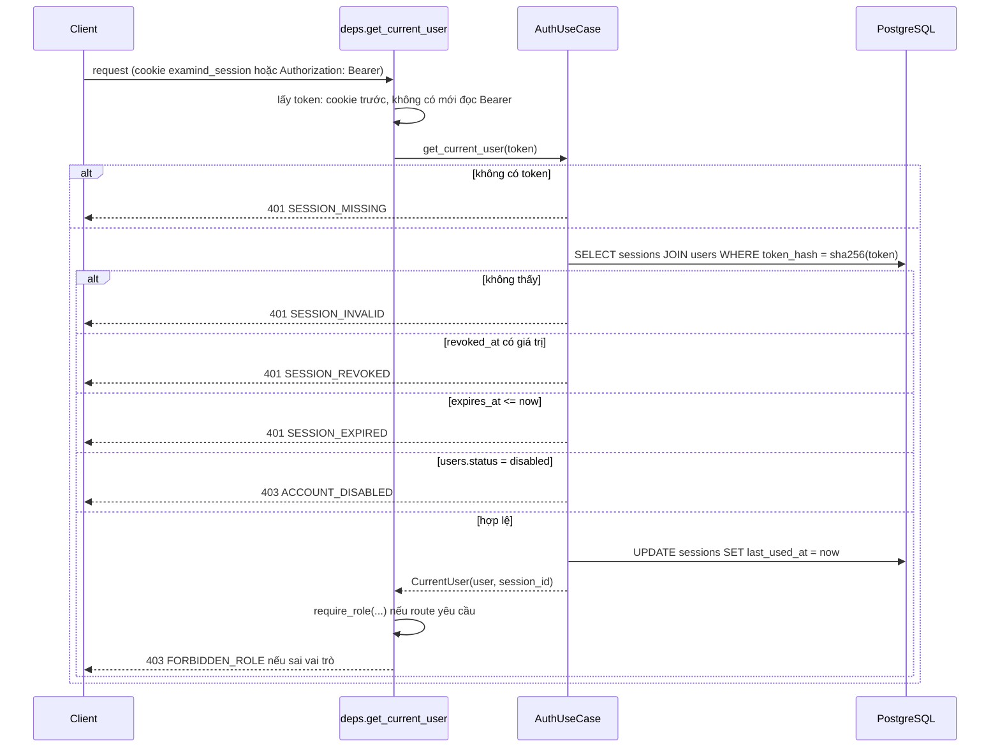
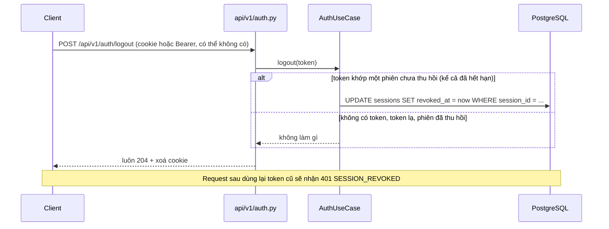
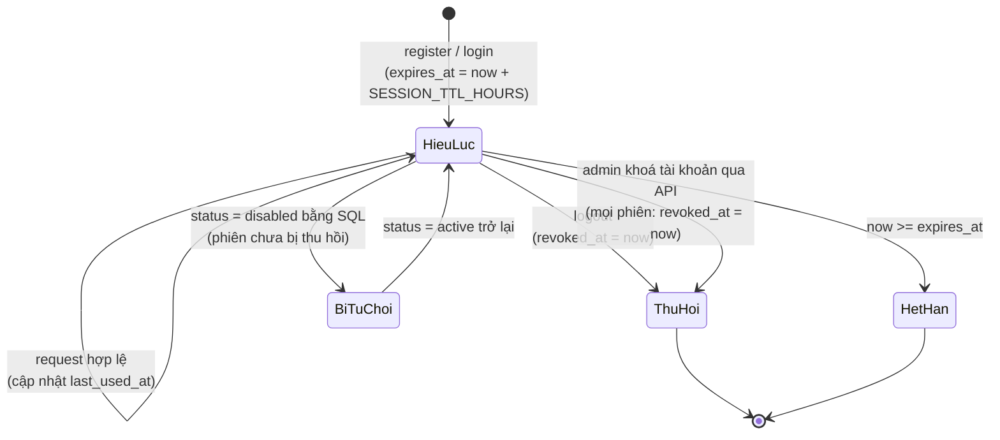

# Xác thực và phân quyền backend

Tài liệu này dành cho người viết backend của các issue #3, #4, #5, #11 cần kiểm quyền, và cho người làm frontend #9 cần biết phiên đăng nhập hoạt động thế nào. Nội dung gồm cơ chế đăng ký, đăng nhập, phiên và phân quyền của issue #8. Hợp đồng HTTP chi tiết nằm ở [API xác thực](../api/auth-api.md).

## Bối cảnh và ràng buộc

- Có hai vai trò là `student` và `admin`. Đăng ký công khai luôn tạo `student`. Quyền admin chỉ đến từ người vận hành máy chủ (biến môi trường hoặc CLI) hoặc từ một admin đang active đã nhập lại mật khẩu (xem [Cấp tài khoản admin](#cấp-tài-khoản-admin)).
- Cần đăng xuất và thu hồi phiên có hiệu lực ngay, nên dùng **token opaque lưu trong CSDL**, không dùng JWT.
- Thiết kế giả định frontend (Next.js trên Vercel) gọi backend qua rewrites `/api/*`, nên trình duyệt chỉ thấy một origin, cookie là cùng site và không cần CORS kèm credentials. Ngày 2026-11-28, frontend trên `main` vẫn gọi thẳng `NEXT_PUBLIC_API_BASE_URL` và chưa có rewrites (việc của #9).
- Prod chạy sau nginx. Từ commit `4c3058d`, nginx có cấu hình HTTPS (Let's Encrypt) cho `examind.duckdns.org` ([deploy-backend-ci-cd.md](../operations/deploy-backend-ci-cd.md)).
- Chưa có bảng nào chứa tài nguyên riêng của học sinh (phiên chat, đề nháp). Quy ước sở hữu ở mục cuối áp dụng khi #4 thêm các bảng đó.

## Thành phần và trách nhiệm

| Lớp | File | Trách nhiệm |
| --- | --- | --- |
| API | `app/api/v1/auth.py` | Route `/auth/*`, đặt và xoá cookie, đổi `AuthError` thành HTTP |
| API | `app/api/v1/admin.py` | `GET /admin/ping`: mẫu một router chỉ cho admin, không ghi DB. Giữ lại vì frontend mock và kiểm nhanh phiên admin đang dùng |
| API | `app/api/v1/admin_accounts.py` | `/admin/accounts`: danh sách, tạo, khoá/mở khoá admin ([API](../api/admin-accounts-api.md)) |
| API | `app/api/deps.py` | `get_session_token`, `get_current_user`, `require_role(...)`, `AdminDep`, `StudentDep`, `CurrentUserDep`. Đây là nơi duy nhất ghép usecase, repository và service |
| API | `app/api/errors.py`, `app/api/cookies.py` | Body lỗi `{"detail", "code"}`, bảng mã HTTP, thuộc tính cookie |
| Usecase | `app/usecase/auth.py` | `register`, `login`, `logout`, `get_current_user`, `create_user`, `ensure_role`. Chứa luật nghiệp vụ, không biết HTTP |
| Usecase | `app/usecase/admin_accounts.py` | `ensure_default_admin`, `list_admins`, `create_admin`, `set_status`: luật cấp quyền admin, nhập lại mật khẩu, chặn tự khoá và khoá admin cuối |
| Service | `app/service/password_service.py` | Băm và kiểm mật khẩu bằng argon2id (chạy trong threadpool), kèm hash giả để chống dò email qua thời gian phản hồi |
| Service | `app/service/token_service.py` | Sinh token bằng `secrets.token_urlsafe(32)` và băm SHA-256 |
| Repository | `app/repositories/user_repository.py`, `session_repository.py` | Đọc ghi `users`, `sessions` |
| Model | `app/models/user.py`, `app/models/session.py` | ORM. Migration `0003_auth.py` (bảng) và `0004_users_created_by.py` |
| CLI | `app/cli/ensure_admin.py` | Tạo admin mặc định từ `ADMIN_*` nếu chưa có. Chạy trong `db-init` |
| CLI | `app/cli/create_admin.py` | Cứu hộ: tạo admin bằng tay. Mật khẩu lấy từ `ADMIN_PASSWORD` hoặc getpass |

Luật nằm ở usecase. Lớp API chỉ đọc cookie hoặc header rồi đổi lỗi sang mã HTTP. Không lớp nào log mật khẩu, token hay hash.

### Dữ liệu



Email được bỏ khoảng trắng hai đầu và chuyển về chữ thường trước khi lưu và trước khi so sánh. Unique index `uq_users_email_lower` trên `lower(email)` chặn trùng email ở mức CSDL, kể cả khi hai request đăng ký chạy song song. Cột `created_by` của `questions` và `exams` (migration 0002) chưa nối khoá ngoại sang `users`.

## Luồng dữ liệu và tích hợp

### Đăng ký và đăng nhập

```mermaid
sequenceDiagram
  participant B as Trình duyệt
  participant N as Next.js (rewrites /api/*)
  participant A as api/v1/auth.py
  participant U as AuthUseCase
  participant DB as PostgreSQL
  B->>N: POST /api/v1/auth/register {email, password}
  N->>A: chuyển tiếp
  A->>A: kiểm schema (EmailStr, mật khẩu 8–128); bỏ qua trường role
  A->>U: register(email, password)
  U->>DB: có email (lower) chưa?
  alt đã có
    U-->>A: EmailAlreadyRegistered
    A-->>B: 409 EMAIL_TAKEN
  else chưa có
    U->>U: argon2id(password)
    U->>DB: INSERT users (role=student)
    U->>U: token = token_urlsafe(32)
    U->>DB: INSERT sessions (token_hash = sha256(token), expires_at = now + TTL)
    U-->>A: (user, token)
    A-->>B: 201 UserOut + Set-Cookie examind_session=token
  end
```

Đăng nhập theo cùng khung, với các bước kiểm như sau:

1. Không có email thì vẫn chạy `verify_dummy` (argon2 trên một hash giả) rồi trả 401 `INVALID_CREDENTIALS`.
2. Sai mật khẩu cũng trả đúng thông báo đó, nên người gọi không phân biệt được hai trường hợp.
3. Chỉ khi mật khẩu đúng mà tài khoản `disabled` thì mới trả 403 `ACCOUNT_DISABLED`.
4. Đăng nhập thành công thì cập nhật `last_login_at` và mở một phiên mới. Các phiên khác của cùng người dùng vẫn giữ nguyên.

### Kiểm phiên ở mỗi request



Với 4 lỗi `SESSION_INVALID`, `SESSION_EXPIRED`, `SESSION_REVOKED`, `ACCOUNT_DISABLED`, phản hồi kèm lệnh xoá cookie (`Max-Age=0`) để trình duyệt không gửi lại token hỏng.

### Đăng xuất



### Vòng đời phiên



- Hạn phiên cố định tính từ lúc tạo, mặc định 168 giờ (7 ngày). Chưa có gia hạn trượt.
- Khoá tài khoản (`status = disabled`) có hiệu lực ngay với mọi phiên đang mở, vì mỗi request đều đọc lại `users.status` (403 `ACCOUNT_DISABLED`).
- Khoá admin qua `PATCH /admin/accounts/{id}/status` còn thu hồi mọi phiên của người đó, nên request tiếp theo nhận 401 `SESSION_REVOKED`. Mở khoá thì họ phải đăng nhập lại. Khoá và mở khoá student chưa có API, vẫn phải đổi bằng SQL.
- Phiên đã thu hồi hoặc hết hạn vẫn nằm trong bảng `sessions`. Chưa có job dọn.

### Cookie và cấu hình

| Biến | Mặc định | Ý nghĩa |
| --- | --- | --- |
| `COOKIE_NAME` | `examind_session` | Tên cookie phiên |
| `COOKIE_SECURE` | `false` | `true` khi trình duyệt tới qua HTTPS. Local để `false` |
| `SESSION_TTL_HOURS` | `168` | Hạn phiên, cũng là `Max-Age` của cookie |
| `CORS_ORIGINS` | rỗng | Rỗng thì không bật CORS. Chỉ đặt khi dev cho frontend gọi thẳng backend khác origin; khi đó CORS bật `allow_credentials` |
| `ADMIN_EMAIL`, `ADMIN_PASSWORD`, `ADMIN_NAME` | rỗng | Admin mặc định do `ensure_admin` tạo trong `db-init`. Chỉ đặt trong `.env`, `prod.env`, không commit. Prod cần mật khẩu ≥ 12 ký tự |

Cookie luôn có `HttpOnly`, `SameSite=Lax`, `Path=/`. JavaScript trên trình duyệt không đọc được token, frontend chỉ cần gửi request kèm cookie (cùng origin thì trình duyệt tự gửi).

### Ma trận quyền

| Nhóm endpoint | Khách | student | admin | Dependency |
| --- | --- | --- | --- | --- |
| `GET /health`, `/health/live` | ✓ | ✓ | ✓ | không |
| `POST /auth/register`, `/auth/login` | ✓ | ✓ | ✓ | không |
| `POST /auth/logout` | ✓ (204, idempotent) | ✓ | ✓ | `get_session_token` (không bắt buộc phiên) |
| `GET /auth/me` | 401 | ✓ | ✓ | `CurrentUserDep` |
| `GET /admin/ping` (mẫu) | 401 | 403 | ✓ | `AdminDep` |
| `GET /admin/accounts` | 401 | 403 | ✓ | `AdminDep` |
| `POST /admin/accounts`, `PATCH /admin/accounts/{id}/status` | 401 | 403 | ✓ kèm `current_password` | `AdminDep` + nhập lại mật khẩu ở usecase |
| Chat tạo đề và đề nháp học sinh (#4) | 401 | ✓ chỉ tài nguyên của mình | 403 *(đề xuất)* | `StudentDep` + kiểm chủ sở hữu ở usecase |
| Nhập PDF (#3) | 401 | 403 | ✓ | `AdminDep` |
| Mẫu cấu trúc đề (#5): xem | 401 | ✓ | ✓ | `CurrentUserDep` |
| Mẫu cấu trúc đề (#5): tạo, sửa, xoá | 401 | 403 | ✓ | `AdminDep` |
| Ngân hàng câu và chương (#11): quản lý | 401 | 403 | ✓ | `AdminDep` |
| Endpoint mẫu `sample-items`, `sample-files` | ✓ | ✓ | ✓ | không (sẽ xoá khi có tính năng thật) |

Các dòng #3, #4, #5, #11 là đề xuất. Người làm issue đó chốt lại và cập nhật bảng này. Việc admin có được xem đề nháp của học sinh hay không cũng chưa chốt (xem câu hỏi mở).

### Áp dụng cho SSE (#4)

`EventSource` của trình duyệt không gửi được header `Authorization`, nên stream SSE phải xác thực bằng cookie:

- Router SSE dùng `StudentDep` như mọi route khác. Cookie `examind_session` đi kèm tự động vì cùng origin (qua rewrites của Next.js).
- Kiểm phiên một lần khi mở stream. Nếu phiên bị thu hồi giữa chừng, stream đang chạy không tự đóng. Nên giới hạn thời lượng stream và để client mở lại, lúc mở lại phiên sẽ được kiểm lần nữa.
- Không đưa token vào query string (`?token=`), vì URL bị ghi vào log nginx và lịch sử trình duyệt.

### Quy ước quyền sở hữu tài nguyên của học sinh

Áp dụng khi #4 thêm bảng có cột chủ sở hữu (vd `owner_id` trỏ tới `users.user_id`):

1. Route nhận `current: StudentDep` rồi truyền `current.user_id` xuống usecase.
2. Usecase tải tài nguyên rồi kiểm `resource.owner_id == current.user_id`. Nếu không khớp, xử lý **như không tồn tại** (404) để không lộ tài nguyên có tồn tại hay không.
3. Truy vấn danh sách luôn lọc theo `owner_id` ngay trong repository, không lọc sau khi đã tải.

### Cấp tài khoản admin

Không có đường HTTP công khai nào tạo được admin. Có đúng ba cách:

| Cách | Ai làm | Khi nào dùng | `created_by` |
| --- | --- | --- | --- |
| `python -m app.cli.ensure_admin` (tự chạy trong `db-init`, sau `alembic upgrade head`) | Người vận hành, qua `ADMIN_EMAIL`, `ADMIN_PASSWORD`, `ADMIN_NAME` trong `.env` / `prod.env` | Có admin đầu tiên ngay khi dựng môi trường mới (local hoặc lần deploy đầu) | `NULL` |
| `POST /api/v1/admin/accounts` | Admin đang active, đã đăng nhập, nhập lại mật khẩu của mình | Thêm admin thứ hai trở đi trong vận hành bình thường | admin đang thao tác |
| `python -m app.cli.create_admin --email ...` | Người vận hành có quyền vào máy chủ | Cứu hộ: mọi admin đều bị khoá hoặc quên mật khẩu | `NULL` |

`ensure_admin` là idempotent và **không bao giờ sửa** tài khoản đã có:

| Tình huống | Kết quả | Mã thoát |
| --- | --- | --- |
| Thiếu `ADMIN_EMAIL` hoặc `ADMIN_PASSWORD` | Bỏ qua | 0 |
| Chưa có email này | Tạo admin active | 0 |
| Email đã là admin | "Admin mặc định đã có, không thay đổi": không ghi đè mật khẩu, không đổi status | 0 |
| Email đang thuộc student | Cảnh báo; không nâng quyền, không đổi mật khẩu hay status | 0 |
| Email sai, mật khẩu ngoài 8–128 ký tự, hoặc `COOKIE_SECURE=true` mà mật khẩu < 12 ký tự | Báo lỗi | 2 |

Mã thoát khác 0 làm `db-init` thất bại, nên backend không khởi động. Trên EC2, `remote-deploy.sh` khi đó quay về commit trước. Chỉ dữ liệu vào sai mới gây lỗi, trong đó có mật khẩu dưới 12 ký tự trên prod: chủ ý không để prod chạy với admin mặc định yếu. Email trùng (kể cả student) chỉ cảnh báo và thoát mã 0, theo review PR #17, để một cấu hình email lỡ trùng không chặn cả lần deploy. `ensure_admin` không chạy trong lifespan của FastAPI, vì nhiều worker có thể chạy cùng lúc và tạo trùng. Trong `docker-compose.prod.yml`, `db-init` nhận `COOKIE_SECURE` mặc định `true` để luật 12 ký tự có hiệu lực.

Vì `ensure_admin` không ghi đè, đổi `ADMIN_PASSWORD` sau lần chạy đầu **không** đổi mật khẩu của admin đã có. Mật khẩu chỉ có tác dụng ở lần tạo.

Luật chống chiếm quyền khi admin quản lý admin:

| Luật | Lý do |
| --- | --- |
| Tạo, khoá, mở khoá đều đòi `current_password` (sai thì 401 `REAUTH_FAILED`, không đổi gì) | Phiên bị lộ (máy dùng chung, cookie bị đánh cắp) không đủ để tự cấp thêm admin hay khoá admin khác |
| Ghi `created_by` = admin đang thao tác | Truy được ai đã cấp quyền cho ai |
| Email đã có, kể cả student, trả 409 `EMAIL_TAKEN` | Không có đường nâng student thành admin; admin muốn cấp quyền thì tạo tài khoản mới với email khác |
| Không tự đổi trạng thái của mình (409 `CANNOT_MODIFY_SELF`) | Tránh tự khoá nhầm. Muốn rời quyền thì nhờ admin khác khoá |
| Không khoá admin active cuối cùng (409 `LAST_ADMIN`) | Luôn còn người quản trị. Kiểm trong cùng transaction sau `SELECT ... FOR UPDATE` các dòng admin (sắp theo `user_id`), nên hai admin khoá lẫn nhau cùng lúc thì request sau thấy chỉ còn một admin active và bị từ chối. Đã kiểm trên PostgreSQL, đối chứng bỏ khoá thì mất hết admin ([luồng kiểm thử](../api/admin-accounts-api.md#luồng-kiểm-thử)) |
| Khoá thì thu hồi mọi phiên của người bị khoá, trong cùng transaction | Người bị khoá mất quyền ngay ở request tiếp theo, không chờ hết hạn phiên |

## Quyết định và cách kiểm chứng

| Quyết định | Lý do |
| --- | --- |
| Token opaque, CSDL chỉ lưu SHA-256 | Thu hồi ngay khi đăng xuất hoặc khoá tài khoản. Lộ CSDL cũng không dùng được token |
| argon2id (`argon2-cffi`, tham số mặc định) | Thuật toán được khuyến nghị cho băm mật khẩu. Băm chạy trong threadpool để không chặn event loop |
| Cookie ưu tiên hơn Bearer | Trình duyệt dùng cookie. Bearer chỉ để thử bằng curl hoặc Swagger |
| Body lỗi `{"detail", "code"}` | Giữ `detail` như [API mẫu](../api/sample-api.md), thêm `code` để frontend phân nhánh. Lỗi 422 của FastAPI giữ nguyên định dạng mặc định |
| Đăng ký bỏ qua trường lạ (gồm `role`) | Không thể tự tạo admin. Frontend gửi dư trường cũng không lỗi |
| Tài khoản bị khoá còn phiên: 403 `ACCOUNT_DISABLED` | Frontend báo đúng lý do thay vì đưa về trang đăng nhập |
| Đăng nhập tài khoản bị khoá: chỉ 403 khi mật khẩu đúng | Người không biết mật khẩu không dò được tài khoản nào bị khoá |
| Đăng ký trả 409 khi email đã có | Chấp nhận lộ việc email đã tồn tại ở bước đăng ký, để người dùng biết mà đăng nhập. Đăng nhập thì không lộ |
| Mật khẩu mới tối thiểu 8 ký tự (theo review PR #17), tối đa 128 | 6 ký tự quá yếu trước tấn công dò mật khẩu. Luật chỉ áp cho mật khẩu mới; đăng nhập không kiểm độ dài nên tài khoản cũ có mật khẩu 6–7 ký tự vẫn vào được. Admin mặc định trên prod vẫn cần ≥ 12 |
| Email dùng kiểm tra chặt của `EmailStr` | `email-validator` từ chối tên miền dùng riêng như `.local`, `.test`. Email admin và tài khoản demo dùng tên miền thật hoặc `example.com` |

Kiểm chứng:

- `cd backend && pytest -q`: 70 test, gồm `tests/test_auth.py`, `test_create_admin_cli.py`, `test_ensure_admin_cli.py`, `test_admin_accounts.py`. Chạy bằng SQLite, không cần Docker. SQLite không có khoá dòng, nên ca khoá đồng thời chỉ kiểm thủ công trên PostgreSQL.
- Kiểm tay với PostgreSQL: [run-local-stack.md](../operations/run-local-stack.md), luồng curl ở [auth-api.md](../api/auth-api.md#luồng-kiểm-thử) và [admin-accounts-api.md](../api/admin-accounts-api.md#luồng-kiểm-thử).

### Chưa làm

| Việc | Đề xuất khi làm |
| --- | --- |
| Giới hạn số lần thử đăng nhập và đăng ký | Đếm số lần sai theo IP và theo email (bảng `login_attempts` hoặc bộ nhớ đệm), khoá tạm vài phút sau khoảng 5–10 lần sai, trả 429 `TOO_MANY_ATTEMPTS`. Có thể thêm `limit_req` ở nginx cho `/api/v1/auth/` làm lớp ngoài |
| Đổi mật khẩu | Yêu cầu mật khẩu cũ. Thu hồi mọi phiên khác của người dùng |
| Quên và đặt lại mật khẩu qua email | Cần dịch vụ gửi mail và bảng token đặt lại có hạn ngắn |
| Xác thực email | Cần dịch vụ gửi mail |
| Đăng nhập Google | OAuth. Cần quyết cách gộp với tài khoản cùng email |
| Khoá, mở khoá tài khoản student và xem danh sách học sinh | Thuộc phần admin (#11). Dùng lại `SessionRepository.revoke_all_for_user` khi khoá |
| Hạ admin thành student | Cần luật "không hạ admin cuối" giống `LAST_ADMIN`, có nhập lại mật khẩu, thu hồi phiên |
| Xoá tài khoản | Cân nhắc khoá thay vì xoá; `created_by` của người khác sẽ thành `NULL` (`ON DELETE SET NULL`) |
| Admin đặt lại mật khẩu cho người khác | Nhập lại mật khẩu, sinh mật khẩu tạm buộc đổi ở lần đăng nhập sau, thu hồi phiên của người đó |
| Giới hạn số lần nhập sai `current_password` | Như giới hạn đăng nhập: đếm theo admin, khoá tạm thao tác quản lý sau vài lần sai |
| Nhật ký thao tác admin | Bảng `admin_audit_log` (ai, làm gì, với ai, lúc nào); hiện chỉ có `created_by` |
| Dọn phiên hết hạn | Job định kỳ xoá `sessions` đã hết hạn hoặc thu hồi quá N ngày |
| Chống CSRF ngoài `SameSite=Lax` | Lax đã chặn request ghi (POST) từ site khác. Nếu sau này có GET làm thay đổi dữ liệu hoặc cần cookie khác site, thêm token CSRF |

### Câu hỏi mở

1. nginx đã có cấu hình HTTPS, nhưng container backend chưa nhận `COOKIE_SECURE` (chỉ `db-init` nhận, để áp luật mật khẩu 12 ký tự). Có bật `COOKIE_SECURE=true` cho backend trên prod không? Cần Đức xác nhận (#13).
2. Admin có được xem chat hay đề nháp của học sinh không (#4, #11)?
3. Có cần thu hồi mọi phiên cũ khi người dùng đăng nhập ở thiết bị mới không? Hiện là không.
4. Admin tạo qua API có cần luật mật khẩu ≥ 12 ký tự trên prod như admin mặc định không? Hiện là 8–128.

## Tài liệu liên quan

- [API xác thực](../api/auth-api.md) · [API quản lý tài khoản admin](../api/admin-accounts-api.md)
- [Các lớp backend](backend-layers.md) · [Tổng quan hệ thống](system-overview.md)
- [Chạy bộ khung local](../operations/run-local-stack.md)
- Đặc tả: [spec.md](../../spec.md) §4 (chỗ người duyệt) và §9 (dữ liệu học sinh)
