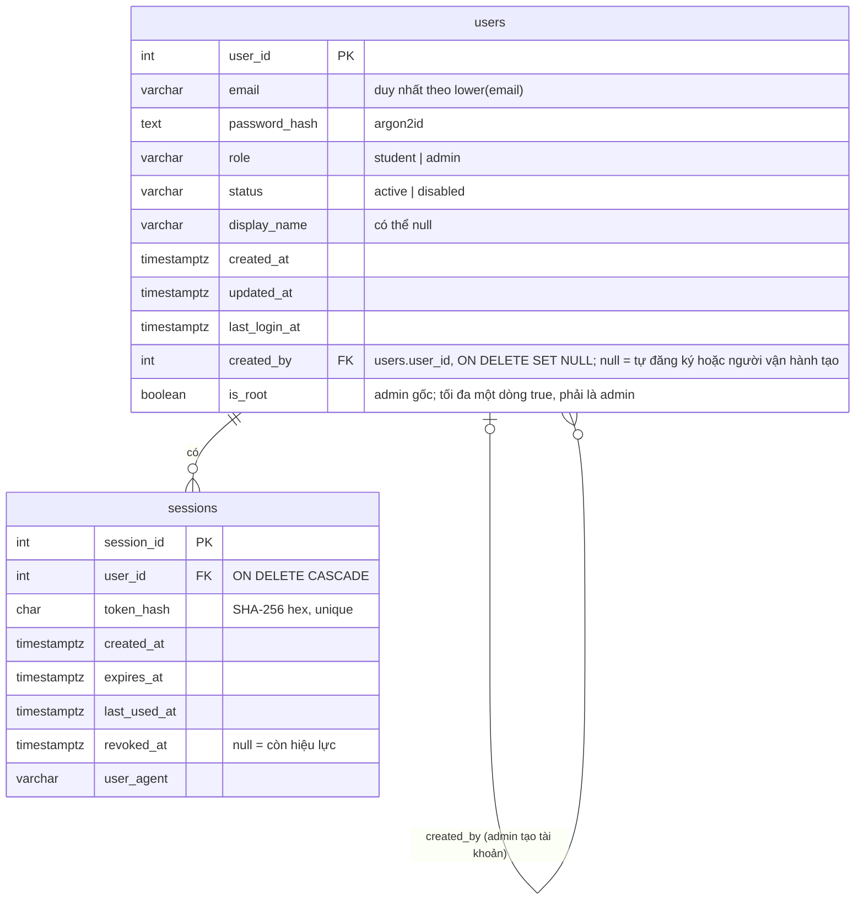
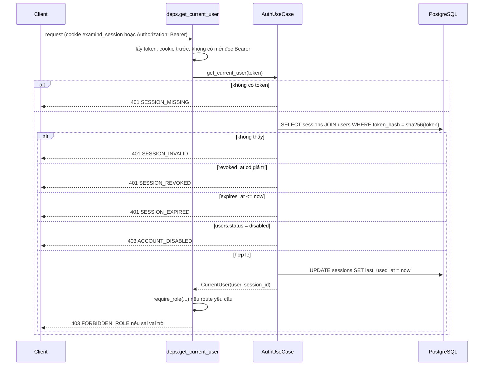
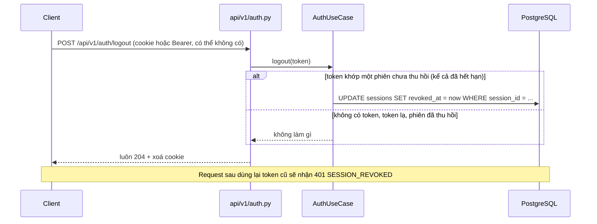
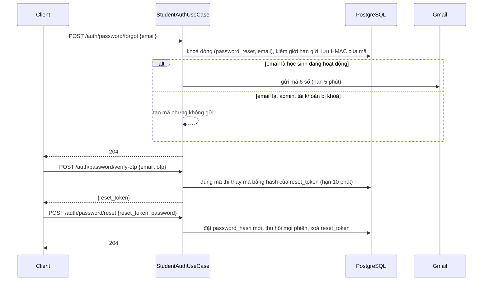
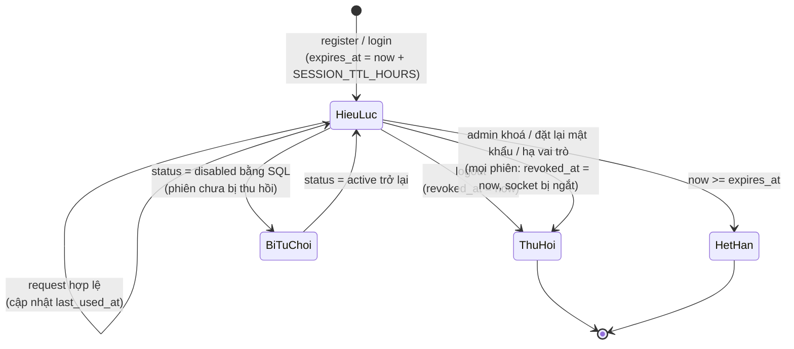

# Xác thực và phân quyền backend

Tài liệu này dành cho người viết backend của các issue #3, #4, #5, #11 cần kiểm quyền, và cho người làm frontend #9 cần biết phiên đăng nhập hoạt động thế nào. Nội dung gồm cơ chế đăng ký, đăng nhập, phiên và phân quyền của issue #8. Hợp đồng HTTP chi tiết nằm ở [API xác thực](../api/auth-api.md).

## Bối cảnh và ràng buộc

- Có hai vai trò là `student` và `admin`. Đăng ký công khai luôn tạo `student`. Quyền admin chỉ đến từ người vận hành máy chủ (biến môi trường hoặc CLI) hoặc từ **admin gốc** qua API (xem [Cấp tài khoản admin](#cấp-tài-khoản-admin)).
- Cần đăng xuất và thu hồi phiên có hiệu lực ngay, nên dùng **token opaque lưu trong CSDL**, không dùng JWT.
- Thiết kế giả định frontend (Next.js trên Vercel) gọi backend qua rewrites `/api/*`, nên trình duyệt chỉ thấy một origin, cookie là cùng site và không cần CORS kèm credentials. Ngày 2026-11-28, frontend trên `main` vẫn gọi thẳng `NEXT_PUBLIC_API_BASE_URL` và chưa có rewrites (việc của #9).
- Prod chạy sau nginx. Từ commit `4c3058d`, nginx có cấu hình HTTPS (Let's Encrypt) cho `examind.duckdns.org` ([deploy-backend-ci-cd.md](../operations/deploy-backend-ci-cd.md)).
- Chưa có bảng nào chứa tài nguyên riêng của học sinh (phiên chat, đề nháp). Quy ước sở hữu ở mục cuối áp dụng khi #4 thêm các bảng đó.

## Thành phần và trách nhiệm

| Lớp | File | Trách nhiệm |
| --- | --- | --- |
| API | `app/api/v1/auth.py` | Route `/auth/*`, đặt và xoá cookie, đổi `AuthError` thành HTTP |
| API | `app/api/v1/admin.py` | `GET /admin/ping`: mẫu một router chỉ cho admin, không ghi DB. Giữ lại vì frontend mock và kiểm nhanh phiên admin đang dùng |
| API | `app/api/v1/admin_users.py` | `/admin/users`: quản lý học sinh và admin (#20, [API](../api/user-management-api.md)). Thay thế `/admin/accounts` của #8 |
| API | `app/api/deps.py` | `get_session_token`, `get_current_user`, `require_role(...)`, `AdminDep`, `StudentDep`, `CurrentUserDep`. Đây là nơi duy nhất ghép usecase, repository và service |
| API | `app/api/errors.py`, `app/api/cookies.py` | Body lỗi `{"detail", "code"}`, bảng mã HTTP, thuộc tính cookie |
| Usecase | `app/usecase/auth.py` | `register`, `login`, `logout`, `get_current_user`, `create_user`, `ensure_role`. Chứa luật nghiệp vụ, không biết HTTP |
| Usecase | `app/usecase/student_auth.py` | Điều phối OTP và ticket Google cho học sinh |
| Service | `app/service/google_identity.py`, `email_service.py`, `email_templates.py` | Kiểm danh tính Google, dựng MIME và gửi Gmail |
| Repository | `app/repositories/auth_challenge_repository.py` | Lưu yêu cầu OTP và trao đổi ticket Google một lần |
| Usecase | `app/usecase/user_management.py` | Hàm thuần `can_manage` (ai được làm gì với ai) và `UserManagementUseCase`: tạo, sửa, khoá, đặt lại mật khẩu; thu hồi phiên và ngắt socket khi khoá, đặt lại mật khẩu, hạ vai trò |
| Usecase | `app/usecase/default_admin.py` | `ensure_default_admin`: tạo hoặc đánh dấu admin gốc từ `ADMIN_*` |
| Service | `app/service/password_service.py` | Băm và kiểm mật khẩu bằng argon2id (chạy trong threadpool), kèm hash giả để chống dò email qua thời gian phản hồi |
| Service | `app/service/token_service.py` | Sinh token bằng `secrets.token_urlsafe(32)` và băm SHA-256 |
| Repository | `app/repositories/user_repository.py`, `session_repository.py` | Đọc ghi `users`, `sessions` |
| Model | `app/models/user.py`, `app/models/session.py` | ORM. Migration `0003_auth.py` (bảng), `0004_users_created_by.py`, `0018_users_is_root.py` (admin gốc) |
| CLI | `app/cli/ensure_admin.py` | Tạo admin gốc từ `ADMIN_*` nếu chưa có. Chạy trong `db-init` |
| CLI | `app/cli/create_admin.py` | Cứu hộ: tạo admin bằng tay. Mật khẩu lấy từ `ADMIN_PASSWORD` hoặc getpass |

Luật nằm ở usecase. Lớp API chỉ đọc cookie hoặc header rồi đổi lỗi sang mã HTTP. Không lớp nào log mật khẩu, token hay hash.

### Dữ liệu

Email được bỏ khoảng trắng hai đầu và chuyển về chữ thường trước khi lưu và trước khi so sánh. Unique index `uq_users_email_lower` trên `lower(email)` chặn trùng email ở mức CSDL, kể cả khi hai request đăng ký chạy song song. Cột `created_by` của `questions` và `exams` (migration 0002) chưa nối khoá ngoại sang `users`.

## Luồng dữ liệu và tích hợp

### Đăng ký và đăng nhập

Đăng ký bằng mật khẩu lưu hash Argon2 của mật khẩu và HMAC của OTP trong `email_challenges`. Mã hết hạn sau 5 phút và khóa sau 5 lần nhập sai. Mã đúng tạo học sinh và phiên trong cùng transaction.

Google Sign-In dùng Authorization Code với PKCE, state có chữ ký và nonce. Backend xác minh ID token, cấp ticket dùng một lần trong 2 phút. Tab giữ verifier tương ứng mới đổi được ticket. Với email chưa liên kết mà Google không quản lý tên miền, hệ thống gửi OTP để kiểm tra quyền sở hữu hộp thư.

Backend tự tạo học sinh hoặc nối vào tài khoản học sinh cùng email đã xác minh, giữ ID và dữ liệu. Các lần sau nhận diện bằng Google `sub`. Mật khẩu của tài khoản đã xác minh được giữ. Khi nối lần đầu vào tài khoản cũ chưa xác minh, backend vô hiệu hóa mật khẩu cũ và thu hồi các phiên trước đó. Điều này chặn mật khẩu do người chưa chứng minh quyền sở hữu email đặt. Tài khoản đó tiếp tục đăng nhập qua Google. Admin dùng luồng mật khẩu.

Template thư nằm trong `backend/app/templates/email/`. Thư OTP dùng `base.html` và `otp.html`, nhúng logo PNG của frontend và đính kèm bản văn bản thuần.

### Kiểm phiên ở mỗi request

Với 4 lỗi `SESSION_INVALID`, `SESSION_EXPIRED`, `SESSION_REVOKED`, `ACCOUNT_DISABLED`, phản hồi kèm lệnh xoá cookie (`Max-Age=0`) để trình duyệt không gửi lại token hỏng.

### Đăng xuất

### Quên mật khẩu

Dùng lại bảng `email_challenges` với `purpose = "password_reset"`, mỗi email một dòng. Code ở `StudentAuthUseCase` (`start_password_reset`, `verify_password_reset`, `reset_password`).

- Email lạ đi cùng đường với email có tài khoản: cùng 204, cùng giới hạn gửi (429 `OTP_RESEND_LIMIT`), cùng `OTP_INVALID` khi nhập sai. Mã của email lạ không được gửi đi nên nhập đúng cũng không cấp `reset_token`. Ngoại lệ: lỗi gửi thư (503) chỉ xảy ra với email có tài khoản.
- Admin không tự đặt lại qua email, dùng `app.cli.create_admin` như mục cấp tài khoản admin.
- Đặt lại xong không mở phiên mới. Mọi phiên cũ bị thu hồi, người dùng đăng nhập lại.
- Tài khoản chỉ có Google (`password_hash` rỗng) đặt được mật khẩu bằng luồng này vì đã chứng minh sở hữu email qua OTP.

### Vòng đời phiên

- Hạn phiên cố định tính từ lúc tạo, mặc định 168 giờ (7 ngày). Chưa có gia hạn trượt.
- Khoá tài khoản (`status = disabled`) có hiệu lực ngay với mọi phiên đang mở, vì mỗi request đều đọc lại `users.status` (403 `ACCOUNT_DISABLED`).
- Khoá tài khoản qua `PATCH /admin/users/{id}` (#20), đặt lại mật khẩu hay hạ vai trò còn thu hồi mọi phiên và ngắt mọi socket của người đó: request tiếp theo nhận 401 `SESSION_REVOKED`, socket nhận `session:revoked`. Mở khoá thì họ phải đăng nhập lại.
- Đăng xuất thu hồi phiên hiện tại và ngắt các socket mở bằng ticket của chính phiên đó ([backend-realtime.md](backend-realtime.md)).
- Phiên đã thu hồi hoặc hết hạn vẫn nằm trong bảng `sessions`. Chưa có job dọn.

### Cookie và cấu hình

| Biến | Mặc định | Ý nghĩa |
| --- | --- | --- |
| `COOKIE_NAME` | `examind_session` | Tên cookie phiên |
| `COOKIE_SECURE` | `false` | `true` khi trình duyệt tới qua HTTPS. Local để `false` |
| `SESSION_TTL_HOURS` | `168` | Hạn phiên, cũng là `Max-Age` của cookie |
| `CORS_ORIGINS` | rỗng | Rỗng thì không bật CORS. Chỉ đặt khi dev cho frontend gọi thẳng backend khác origin; khi đó CORS bật `allow_credentials` |
| `ADMIN_EMAIL`, `ADMIN_PASSWORD`, `ADMIN_NAME` | rỗng | Admin gốc do `ensure_admin` tạo trong `db-init`. Chỉ đặt trong `.env`, `prod.env`, không commit. Prod cần mật khẩu ≥ 12 ký tự |

Cookie luôn có `HttpOnly`, `SameSite=Lax`, `Path=/`. JavaScript trên trình duyệt không đọc được token, frontend chỉ cần gửi request kèm cookie (cùng origin thì trình duyệt tự gửi).

### Ma trận quyền

| Nhóm endpoint | Khách | student | admin | Dependency |
| --- | --- | --- | --- | --- |
| `GET /health`, `/health/live` | ✓ | ✓ | ✓ | không |
| `POST /auth/register`, `/auth/login` | ✓ | ✓ | ✓ | không |
| `POST /auth/logout` | ✓ (204, idempotent) | ✓ | ✓ | `get_session_token` (không bắt buộc phiên) |
| `GET /auth/me` | 401 | ✓ | ✓ | `CurrentUserDep` |
| `GET /admin/ping` (mẫu) | 401 | 403 | ✓ | `AdminDep` |
| `POST /auth/socket-ticket` | 401 | ✓ | ✓ | `CurrentUserDep` |
| `GET /admin/users`, `GET /admin/users/{id}` | 401 | 403 | ✓ mọi admin | `AdminDep` |
| `POST`/`PATCH /admin/users`, `/reset-password` với tài khoản học sinh | 401 | 403 | ✓ mọi admin (nâng thành admin: chỉ admin gốc) | `AdminDep` + `can_manage` ở usecase |
| `POST`/`PATCH /admin/users`, `/reset-password` với tài khoản admin | 401 | 403 | ✓ chỉ admin gốc (không ai đụng admin gốc trừ tự sửa tên) | `AdminDep` + `can_manage` ở usecase |
| `GET /admin/stats/online-students` | 401 | 403 | ✓ | `AdminDep` |
| Socket.IO `/api/socket.io` | từ chối | ✓ room `role:student`, `user:{id}` | ✓ room `role:admin`, `user:{id}` | ticket một lần ([realtime-api.md](../api/realtime-api.md)) |
| Chat tạo đề và đề nháp học sinh (#4) | 401 | ✓ chỉ tài nguyên của mình | 403 *(đề xuất)* | `StudentDep` + kiểm chủ sở hữu ở usecase |
| Nhập PDF (#3) | 401 | 403 | ✓ | `AdminDep` |
| Mẫu cấu trúc đề (#5): xem | 401 | ✓ | ✓ | `CurrentUserDep` |
| Mẫu cấu trúc đề (#5): tạo, sửa, xoá | 401 | 403 | ✓ | `AdminDep` |
| Ngân hàng câu và chương (#11): quản lý | 401 | 403 | ✓ | `AdminDep` |
| Endpoint mẫu `sample-items`, `sample-files` | ✓ | ✓ | ✓ | không (sẽ xoá khi có tính năng thật) |

Các dòng #3, #4, #5, #11 là đề xuất. Người làm issue đó chốt lại và cập nhật bảng này. Việc admin có được xem đề nháp của học sinh hay không cũng chưa chốt (xem câu hỏi mở).

### Áp dụng cho SSE (#4)

`EventSource` của trình duyệt không gửi được header `Authorization`, nên stream SSE phải xác thực bằng cookie:

- Router SSE dùng `StudentDep` như mọi route khác. Cookie `examind_session` đi kèm tự động vì cùng origin (qua rewrites của Next.js).
- Kiểm phiên một lần khi mở stream. Nếu phiên bị thu hồi giữa chừng, stream đang chạy không tự đóng. Nên giới hạn thời lượng stream và để client mở lại, lúc mở lại phiên sẽ được kiểm lần nữa.
- Không đưa token vào query string (`?token=`), vì URL bị ghi vào log nginx và lịch sử trình duyệt.

### Quy ước quyền sở hữu tài nguyên của học sinh

Áp dụng khi #4 thêm bảng có cột chủ sở hữu (vd `owner_id` trỏ tới `users.user_id`):

1. Route nhận `current: StudentDep` rồi truyền `current.user_id` xuống usecase.
2. Usecase tải tài nguyên rồi kiểm `resource.owner_id == current.user_id`. Nếu không khớp, xử lý **như không tồn tại** (404) để không lộ tài nguyên có tồn tại hay không.
3. Truy vấn danh sách luôn lọc theo `owner_id` ngay trong repository, không lọc sau khi đã tải.

### Cấp tài khoản admin

Không có đường HTTP công khai nào tạo được admin. **Admin gốc** (`users.is_root`, migration `0018`, tối đa một tài khoản) là tài khoản tạo từ `ADMIN_EMAIL`; chỉ admin gốc tạo, sửa, khoá admin khác và đổi vai trò (#20). Có đúng ba cách có admin:

| Cách | Ai làm | Khi nào dùng | `created_by` | Admin gốc? |
| --- | --- | --- | --- | --- |
| `python -m app.cli.ensure_admin` (tự chạy trong `db-init`, sau `alembic upgrade head`) | Người vận hành, qua `ADMIN_EMAIL`, `ADMIN_PASSWORD`, `ADMIN_NAME` trong `.env` / `prod.env` | Có admin đầu tiên ngay khi dựng môi trường mới | `NULL` | Có |
| `POST /api/v1/admin/users` với `"role": "admin"`, hoặc `PATCH` nâng học sinh thành admin | Admin gốc đã đăng nhập | Thêm admin thường trong vận hành bình thường | admin gốc | Không |
| `python -m app.cli.create_admin --email ...` | Người vận hành có quyền vào máy chủ | Cứu hộ khi không ai đăng nhập được admin gốc | `NULL` | Không |

`ensure_admin` là idempotent và **không bao giờ đổi mật khẩu hay status**:

| Tình huống | Kết quả | Mã thoát |
| --- | --- | --- |
| Thiếu `ADMIN_EMAIL` hoặc `ADMIN_PASSWORD` | Bỏ qua | 0 |
| Chưa có email này, chưa có admin gốc | Tạo admin active, `is_root = true` | 0 |
| Email đã là admin gốc | "Admin mặc định đã có, không thay đổi" | 0 |
| Email là admin thường, chưa có admin gốc (vd admin tạo trước #20) | Đánh dấu làm admin gốc | 0 |
| Đã có admin gốc khác | Cảnh báo, không tạo hay đổi tài khoản nào | 0 |
| Email đang thuộc student | Cảnh báo; không nâng quyền | 0 |
| Email sai, mật khẩu ngoài 8–128 ký tự, hoặc `COOKIE_SECURE=true` mà mật khẩu < 12 ký tự | Báo lỗi | 2 |

Mã thoát khác 0 làm `db-init` thất bại, nên backend không khởi động. Trên EC2, `remote-deploy.sh` khi đó quay về commit trước: chủ ý không để prod chạy với admin gốc yếu. `ensure_admin` không chạy trong lifespan của FastAPI. Trong `docker-compose.prod.yml`, `db-init` nhận `COOKIE_SECURE` mặc định `true` để luật 12 ký tự có hiệu lực. Đổi `ADMIN_PASSWORD` sau lần chạy đầu **không** đổi mật khẩu của admin đã có; đổi `ADMIN_EMAIL` sang email khác cũng không chuyển quyền gốc.

Luật quản lý tài khoản (#20, hàm thuần `can_manage`, bảng đầy đủ ở [user-management-api.md](../api/user-management-api.md#ma-trận-ai-được-làm-gì)):

| Luật | Mã | Lý do |
| --- | --- | --- |
| Admin thường chỉ quản lý học sinh; đụng tài khoản admin hoặc nâng học sinh thành admin bị chặn | 403 `FORBIDDEN_ROLE` | Quyền cấp và gỡ quyền admin tập trung ở một người |
| Không ai khoá, hạ, đổi vai trò, đổi email, đặt lại mật khẩu của admin gốc; admin gốc chỉ tự sửa tên | 403 `CANNOT_MODIFY_ROOT` | Luôn còn một admin, nên không cần luật "admin cuối". Email gốc gắn với `ADMIN_EMAIL` trong cấu hình máy chủ |
| Không tự khoá, không tự hạ vai trò | 403 `CANNOT_MODIFY_SELF` | Tránh tự khoá nhầm |
| Không đặt `is_root` qua API | 422 (schema cấm trường lạ) | Chỉ người vận hành chọn admin gốc |
| Ghi `created_by` = admin đang thao tác | — | Truy được ai đã tạo tài khoản nào |
| Khoá, đặt lại mật khẩu, hạ vai trò: thu hồi mọi phiên rồi ngắt socket | — | Người bị khoá mất quyền ngay ở request và kết nối tiếp theo |

`REAUTH_FAILED` (nhập lại mật khẩu) và `LAST_ADMIN` của `/admin/accounts` cũ không có trong đặc tả #20 nên chưa đưa vào `/admin/users` (xem câu hỏi mở).

## Quyết định và cách kiểm chứng

| Quyết định | Lý do |
| --- | --- |
| Token opaque, CSDL chỉ lưu SHA-256 | Thu hồi ngay khi đăng xuất hoặc khoá tài khoản. Lộ CSDL cũng không dùng được token |
| argon2id (`argon2-cffi`, tham số mặc định) | Thuật toán được khuyến nghị cho băm mật khẩu. Băm chạy trong threadpool để không chặn event loop |
| Cookie ưu tiên hơn Bearer | Trình duyệt dùng cookie. Bearer chỉ để thử bằng curl hoặc Swagger |
| Body lỗi `{"detail", "code"}` | Giữ `detail` như [API mẫu](../api/sample-api.md), thêm `code` để frontend phân nhánh. Lỗi 422 của auth giữ danh sách theo trường và bỏ giá trị nhạy cảm |
| Đăng ký bỏ qua trường lạ (gồm `role`) | Không thể tự tạo admin. Frontend gửi dư trường cũng không lỗi |
| Tài khoản bị khoá còn phiên: 403 `ACCOUNT_DISABLED` | Frontend báo đúng lý do thay vì đưa về trang đăng nhập |
| Đăng nhập tài khoản bị khoá: chỉ 403 khi mật khẩu đúng | Người không biết mật khẩu không dò được tài khoản nào bị khoá |
| Đăng ký trả 409 khi email đã có | Chấp nhận lộ việc email đã tồn tại ở bước đăng ký, để người dùng biết mà đăng nhập. Đăng nhập thì không lộ |
| Mật khẩu mới tối thiểu 8 ký tự (theo review PR #17), tối đa 128 | 6 ký tự quá yếu trước tấn công dò mật khẩu. Luật chỉ áp cho mật khẩu mới; đăng nhập không kiểm độ dài nên tài khoản cũ có mật khẩu 6–7 ký tự vẫn vào được. Admin mặc định trên prod vẫn cần ≥ 12 |
| Email dùng kiểm tra chặt của `EmailStr` | `email-validator` từ chối tên miền dùng riêng như `.local`, `.test`. Email admin và tài khoản demo dùng tên miền thật hoặc `example.com` |

Kiểm chứng:

- `cd backend && pytest -q`: gồm `tests/test_auth.py`, `test_create_admin_cli.py`, `test_ensure_admin_cli.py` (admin gốc), `test_user_permissions.py` (bảng `can_manage`), `test_user_management_api.py` và các test realtime của #20. Chạy bằng SQLite, không cần Docker.
- Kiểm tay với PostgreSQL: [run-local-stack.md](../operations/run-local-stack.md), luồng curl ở [auth-api.md](../api/auth-api.md#luồng-kiểm-thử) và [user-management-api.md](../api/user-management-api.md#luồng-kiểm-thử).

### Chưa làm

| Việc | Đề xuất khi làm |
| --- | --- |
| Giới hạn số lần thử đăng nhập bằng mật khẩu | Đếm số lần sai theo IP và theo email (bảng `login_attempts` hoặc bộ nhớ đệm), khoá tạm vài phút sau khoảng 5–10 lần sai, trả 429 `TOO_MANY_ATTEMPTS`. Có thể thêm `limit_req` ở nginx cho `/api/v1/auth/` làm lớp ngoài |
| Đổi mật khẩu | Yêu cầu mật khẩu cũ. Thu hồi mọi phiên khác của người dùng |
| Xoá tài khoản | Cân nhắc khoá thay vì xoá; `created_by` của người khác sẽ thành `NULL` (`ON DELETE SET NULL`) |
| Buộc đổi mật khẩu sau khi admin đặt lại | Hiện admin đặt mật khẩu mới trực tiếp (#20); chưa có cờ "phải đổi ở lần đăng nhập sau" |
| Nhật ký thao tác admin | Bảng `admin_audit_log` (ai, làm gì, với ai, lúc nào); hiện chỉ có `created_by` |
| Dọn phiên hết hạn | Job định kỳ xoá `sessions` đã hết hạn hoặc thu hồi quá N ngày |
| Chống CSRF ngoài `SameSite=Lax` | Lax đã chặn request ghi (POST) từ site khác. Nếu sau này có GET làm thay đổi dữ liệu hoặc cần cookie khác site, thêm token CSRF |

### Câu hỏi mở

1. nginx đã có cấu hình HTTPS, nhưng container backend chưa nhận `COOKIE_SECURE` (chỉ `db-init` nhận, để áp luật mật khẩu 12 ký tự). Có bật `COOKIE_SECURE=true` cho backend trên prod không? Cần Đức xác nhận (#13).
2. Admin có được xem chat hay đề nháp của học sinh không (#4, #11)?
3. Có cần thu hồi mọi phiên cũ khi người dùng đăng nhập ở thiết bị mới không? Hiện là không.
4. Admin tạo qua API có cần luật mật khẩu ≥ 12 ký tự trên prod như admin gốc không? Hiện là 8–128.
5. (#20) Có giữ `REAUTH_FAILED` (đòi nhập lại mật khẩu khi tạo, khoá admin) cho `/admin/users` không? Hiện theo đặc tả #20: không đòi. `LAST_ADMIN` không còn cần vì admin gốc không khoá được.

## Tài liệu liên quan

- [API xác thực](../api/auth-api.md) · [API quản lý người dùng](../api/user-management-api.md) · [Kiến trúc realtime](backend-realtime.md)
- [Các lớp backend](backend-layers.md) · [Tổng quan hệ thống](system-overview.md)
- [Chạy bộ khung local](../operations/run-local-stack.md)
- Đặc tả: [spec.md](../../spec.md) §4 (chỗ người duyệt) và §9 (dữ liệu học sinh)
