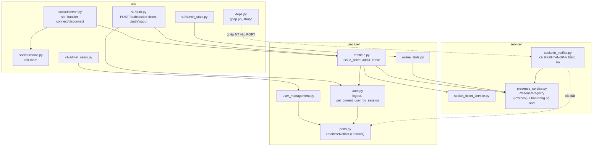
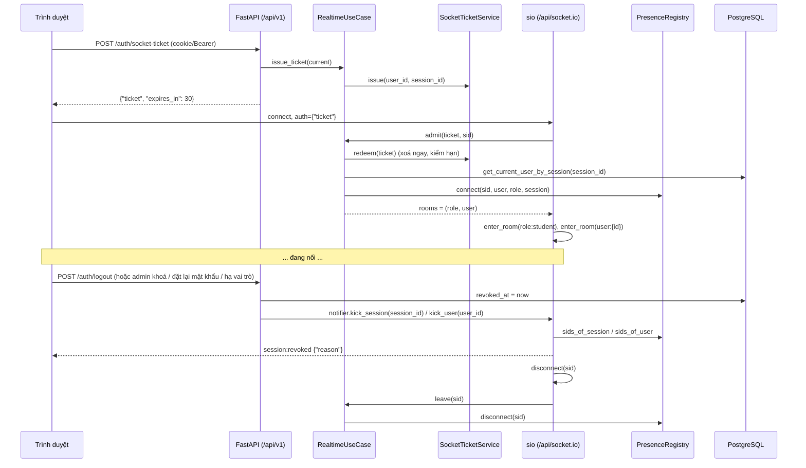

# Kiến trúc realtime backend

Tài liệu này dành cho người sửa hoặc mở rộng kênh Socket.IO của backend: thêm sự kiện, phát tin theo room, hoặc chuyển sang nhiều worker. Phạm vi là phần realtime của issue #20: xác thực socket bằng ticket, room theo vai trò, theo dõi online và ngắt socket khi phiên bị thu hồi. Hợp đồng cho client nằm ở [API realtime](../api/realtime-api.md).

## Bối cảnh và ràng buộc

- Frontend chạy trên Vercel, backend trên EC2: **khác origin**. Vercel rewrites không chuyển WebSocket, nên client nối thẳng backend và cookie phiên `SameSite=Lax` không đi theo handshake.
- Phải biết học sinh nào đang online và ngắt ngay socket của người bị khoá hoặc đăng xuất.
- Code theo bốn lớp ([backend-layers.md](backend-layers.md)): usecase không import `socketio` hay `fastapi`; ghép phụ thuộc ở `app/api/deps.py`.
- Một tiến trình backend (`uvicorn --workers 1`), không có Redis.

## Thành phần và trách nhiệm

| File | Trách nhiệm |
| --- | --- |
| `api/socket/server.py` | Tạo `sio` (`AsyncServer`, ASGI) một lần. Handler `connect` và `disconnect` chỉ gọi `RealtimeUseCase` rồi `enter_room` theo khoá room usecase trả về |
| `api/socket/rooms.py` | Nơi duy nhất sinh tên room: `role:{role}`, `user:{id}` |
| `app/main.py` | `asgi_app = socketio.ASGIApp(sio, other_asgi_app=app, socketio_path="api/socket.io")`. `app` (FastAPI) giữ nguyên cho test |
| `usecase/realtime.py` | Đổi ticket thành người dùng, kiểm lại phiên, chọn room theo vai trò (dạng khoá `("role", ...)`, `("user", ...)`), ghi nhận và gỡ kết nối |
| `usecase/ports.py` | `RealtimeNotifier`: `kick_user(user_id, reason)`, `kick_session(session_id, reason)` |
| `usecase/user_management.py`, `usecase/auth.py` | Gọi notifier sau khi đã thu hồi phiên trong DB |
| `usecase/online_stats.py` | Đọc `PresenceRegistry` cho API thống kê |
| `service/socket_ticket_service.py` | Sinh, đổi ticket; TTL; dùng một lần; chỉ lưu SHA-256; đồng hồ tiêm vào được để test |
| `service/presence_service.py` | `PresenceRegistry`: sid → (user, role, session), user → tập sid, đếm và liệt kê học sinh online |
| `service/socketio_notifier.py` | Gửi `session:revoked` tới đúng các sid rồi `sio.disconnect` |
| `api/deps.py` | `get_presence_registry`, `get_socket_ticket_service`, `get_realtime_notifier` (tạo một lần), `realtime_scope(app)` cho handler socket |

Trạng thái toàn cục chỉ có `sio`, `PresenceRegistry` và kho ticket. Cả ba đều tạo một lần trong tiến trình.

## Luồng dữ liệu và tích hợp

### Xin ticket → nối → vào room → bị thu hồi

- Phiên trong DB bị thu hồi **trước**, rồi mới ngắt socket. Nếu bước ngắt socket lỗi, phiên vẫn đã chết và request HTTP tiếp theo bị 401.
- Handler `connect` từ chối bằng `socketio.exceptions.ConnectionRefusedError(message, {"code": ...})`. Phải dùng lớp này: với `ConnectionRefusedError` có sẵn của Python, client chỉ nhận câu mặc định, mất mã lỗi.
- Handler socket không đi qua dependency injection của FastAPI. `realtime_scope(app)` mở một phiên DB mỗi sự kiện và tôn trọng `app.dependency_overrides`, nên test thay được DB và notifier.

### Định nghĩa online

- **Online** = học sinh có ít nhất một kết nối sống trong `PresenceRegistry`. Nhiều tab, nhiều thiết bị vẫn tính là một học sinh; `connections` cộng đủ.
- **Sống** do ping/pong của Engine.IO quyết định: `ping_interval` 25 s, `ping_timeout` 20 s (khai rõ trong `server.py`). Client mất mạng bị coi là ngắt sau tối đa khoảng 45 s. Đóng tab thì ngắt ngay.

### Ràng buộc một worker

`PresenceRegistry`, kho ticket và danh sách sid của `sio` nằm trong bộ nhớ một tiến trình. Hai worker sẽ:
- đếm online thiếu, vì mỗi worker chỉ thấy kết nối của mình;
- từ chối ticket xin ở worker A nhưng nối ở worker B;
- không ngắt được socket nằm ở worker khác.

Vì vậy Dockerfile chạy `uvicorn app.main:asgi_app --workers 1`. Một tiến trình asyncio đủ cho quy mô demo.

**Kế hoạch chuyển Redis khi cần nhiều worker hoặc nhiều máy:**
1. `socketio.AsyncServer(client_manager=socketio.AsyncRedisManager(REDIS_URL))`, để `emit` và `disconnect` tới sid ở tiến trình khác.
2. `RedisPresenceRegistry` cài đúng giao diện `PresenceRegistry` (async), ví dụ hash `sid → user,role,session` và set `user:{id}:sids`, kèm TTL được làm mới theo ping để dọn kết nối của tiến trình chết.
3. Kho ticket chuyển sang Redis (`SET ticket_hash claim EX 30`, đổi bằng `GETDEL`).
4. Bật sticky session ở nginx nếu còn dùng long-polling (client hiện chỉ dùng `transports: ["websocket"]`).

Usecase không phải sửa; chỉ đổi phần ghép trong `deps.py`.

## Quyết định và cách kiểm chứng

| Quyết định | Lý do |
| --- | --- |
| Ticket một lần, 30 s, thay vì cookie | Khác origin nên cookie không đi theo handshake. Không đưa token phiên vào query string, vì URL bị ghi vào log nginx. Ticket ngắn hạn, dùng một lần nên lộ ra cũng hết giá trị ngay |
| Ticket gắn `session_id`, kiểm lại phiên lúc nối | Phiên bị thu hồi hoặc tài khoản bị khoá trong 30 s giữa lúc xin và lúc nối thì vẫn bị từ chối |
| Đăng xuất gọi `kick_session`, không gửi theo `user:{id}` | **Lệch so với đặc tả #20** (đặc tả gửi vào `user:{id}`). Đăng xuất là thao tác của một phiên: học sinh đăng xuất trên máy trường không nên làm rơi socket trên điện thoại. Khoá, đặt lại mật khẩu, hạ vai trò thì thu hồi mọi phiên nên dùng `kick_user` |
| Usecase trả khoá room, `rooms.py` sinh tên | Usecase quyết định vào room nào mà không phụ thuộc lớp `api/` |
| `cors_allowed_origins = CORS_ORIGINS or None` | `None` = chỉ cùng origin. Truyền `[]` thì python-engineio **tắt hẳn** việc kiểm origin |
| `asgi_app` bọc FastAPI, giữ tên `app` cho FastAPI | Test vẫn dùng `app.dependency_overrides`. uvicorn và Dockerfile chạy `app.main:asgi_app` |

Kiểm chứng:
- `cd backend && pytest -q`: test đơn vị ticket, presence, usecase với đối tượng giả; API ticket và logout; test tích hợp `tests/test_socket_integration.py` chạy uvicorn thật và `socketio.AsyncClient` (nối, room, ticket dùng lại, logout chỉ ngắt đúng phiên, kịch bản 2 tab và admin khoá).
- Kiểm tay: `scripts/socket_smoke.py` trên PostgreSQL ([realtime-api.md](../api/realtime-api.md#luồng-kiểm-thử)).

### Chưa làm

| Việc | Ghi chú |
| --- | --- |
| Ngắt socket khi phiên tự hết hạn | Hiện chỉ kiểm lúc nối. Có thể thêm tác vụ định kỳ quét `PresenceRegistry`, gửi `session:revoked` `{"reason": "expired"}` cho phiên quá `expires_at` |
| Đổi room khi nâng học sinh thành admin | Socket đang mở vẫn ở `role:student` tới khi nối lại |
| Nhiều worker / Redis | Kế hoạch ở trên |
| Sự kiện nghiệp vụ (vd chat tạo đề #4) | Phát qua `sio.emit(..., to=role_room(...) / user_room(...))` từ một port mới như `RealtimeNotifier` |

## Tài liệu liên quan

- [API realtime](../api/realtime-api.md) · [API quản lý người dùng](../api/user-management-api.md)
- [Xác thực và phân quyền backend](backend-auth.md) · [Các lớp backend](backend-layers.md)
- [Deploy backend CI/CD](../operations/deploy-backend-ci-cd.md#socket-và-wss)
