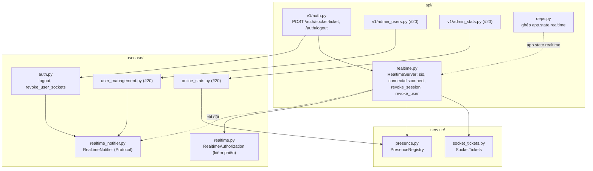

# Kiến trúc realtime backend

Tài liệu này dành cho người sửa hoặc mở rộng kênh Socket.IO của backend: thêm sự kiện, phát tin theo room, hoặc chuyển sang nhiều worker. Phạm vi gồm phần nền realtime có từ #36 (`app/api/realtime.py`) và những gì #20 dùng hoặc thêm vào: room theo vai trò, ngắt socket khi khoá/đặt lại mật khẩu/hạ vai trò, lý do `session:revoked`, thống kê học sinh online. Hợp đồng cho client nằm ở [API realtime](../api/realtime-api.md).

## Bối cảnh và ràng buộc

- Frontend chạy trên Vercel, backend trên EC2: **khác origin**. API `/api/v1/*` đi qua rewrites của Next.js nên có cookie phiên, nhưng rewrites không chuyển WebSocket. Vì vậy client xin ticket qua HTTP rồi nối thẳng backend bằng `NEXT_PUBLIC_SOCKET_URL`.
- Cần biết học sinh nào đang online, và ngắt ngay socket của người bị khoá hoặc đăng xuất.
- Một tiến trình backend (`uvicorn app.main:app --workers 1`), không có Redis.

## Thành phần và trách nhiệm



| File | Trách nhiệm |
| --- | --- |
| `api/realtime.py` | `RealtimeServer`: tạo `socketio.AsyncServer` (ASGI), giữ `SocketTickets` và `PresenceRegistry`, handler `connect`/`disconnect`, room `role:{role}` và `user:{id}` (`rooms_for`), hẹn giờ ngắt khi phiên hết hạn, `revoke_session`/`revoke_user` (cài `RealtimeNotifier`). Cũng phục vụ room `attempt:{id}` và sự kiện `notification:new` |
| `app/main.py` | `app.state.realtime = RealtimeServer(...)`, gắn bằng `RealtimeMiddleware` tại `/api/socket.io` |
| `service/socket_tickets.py` | Ticket ngẫu nhiên, 30 s, dùng một lần, chỉ gắn `session_id` |
| `service/presence.py` | sid → (user, session, role). `for_session`, `for_user`, `users(role)`; #20 thêm `connections_by_user(role)` cho thống kê |
| `usecase/realtime.py` | `RealtimeAuthorization.authorize(session_id)`: kiểm phiên còn hiệu lực và user còn active bằng `validate_session` |
| `usecase/realtime_notifier.py` | Port `RealtimeNotifier`: `revoke_session(session_id, reason)`, `revoke_user(user_id, reason)`. #20 thêm `reason` (tuỳ chọn) và kiểu `RevokeReason` |
| `usecase/auth.py` | Đăng xuất gọi `revoke_session(..., "logout")`; tự đặt lại mật khẩu gọi `revoke_user(..., "password_reset")` |
| `usecase/user_management.py` (#20) | Khoá, đặt lại mật khẩu, hạ vai trò: thu hồi mọi phiên trong DB rồi gọi `revoke_user(user_id, reason)` |
| `usecase/online_stats.py` (#20) | Đếm học sinh online và số kết nối từ `PresenceRegistry`, kèm tên/email từ DB |
| `api/deps.py` | Ghép `request.app.state.realtime` làm notifier cho `AuthUseCase`, `UserManagementUseCase`, và `.presence` cho `OnlineStatsUseCase` |

Usecase chỉ biết Protocol `RealtimeNotifier`; không import `socketio`.

## Luồng dữ liệu và tích hợp

### Xin ticket → nối → vào room → bị thu hồi

```mermaid
sequenceDiagram
  participant B as Trình duyệt
  participant API as FastAPI (/api/v1, qua rewrites)
  participant RS as RealtimeServer (/api/socket.io)
  participant PR as PresenceRegistry
  participant DB as PostgreSQL
  B->>API: POST /auth/socket-ticket (cookie)
  API->>RS: tickets.issue(session_id)
  API-->>B: {"ticket", "expires_in": 30}
  B->>RS: connect (NEXT_PUBLIC_SOCKET_URL), auth={"ticket"}
  RS->>RS: tickets.consume(ticket) → session_id
  RS->>DB: authorize(session_id): phiên còn hiệu lực, user active
  RS->>PR: add(sid, user, session, role)
  RS->>RS: enter_room(role:{role}), enter_room(user:{id}); hẹn giờ tới expires_at
  Note over B,RS: ... đang nối ...
  B->>API: POST /auth/logout (hoặc admin khoá / đặt lại mật khẩu / hạ vai trò)
  API->>DB: revoked_at = now
  API->>RS: revoke_session(session_id, "logout") / revoke_user(user_id, reason)
  RS->>PR: for_session / for_user
  RS-->>B: session:revoked {"reason"}
  RS->>RS: disconnect(sid), presence.remove(sid)
```

- Phiên trong DB bị thu hồi **trước**, rồi mới ngắt socket. Nếu bước ngắt lỗi, phiên vẫn đã chết và request HTTP tiếp theo bị 401.
- Sau khi vào room, `connect` kiểm phiên thêm một lần để đóng khe hở với một lần thu hồi vừa commit trong lúc bắt tay.
- Handshake bị từ chối thì `connect` trả `False`: client nhận `connect_error` chung, không có mã lỗi riêng.

### Định nghĩa online

- **Online** = học sinh có ít nhất một kết nối trong `PresenceRegistry`. Nhiều tab, nhiều thiết bị vẫn tính một học sinh; `connections` cộng đủ.
- **Còn kết nối** do ping/pong mặc định của Engine.IO quyết định (`ping_interval` 25 s, `ping_timeout` 20 s). Client mất mạng bị coi là ngắt sau tối đa khoảng 45 s. Đóng tab thì ngắt ngay.

### Ràng buộc một worker

`PresenceRegistry`, kho ticket, danh sách sid và hẹn giờ hết hạn nằm trong bộ nhớ một tiến trình. Hai worker sẽ đếm online thiếu, từ chối ticket xin ở worker khác, và không ngắt được socket ở worker khác. Dockerfile vì vậy chạy `uvicorn app.main:app --workers 1`. Worker nền `student-worker` là tiến trình riêng nhưng không giữ socket: nó ghi thông báo vào DB, còn tiến trình API đọc và phát.

**Kế hoạch chuyển Redis khi cần nhiều tiến trình:**
1. `socketio.AsyncServer(client_manager=socketio.AsyncRedisManager(REDIS_URL))` để `emit` và `disconnect` tới sid ở tiến trình khác.
2. `PresenceRegistry` dùng Redis (hash `sid → user,session,role`, set theo user, TTL làm mới theo ping để dọn kết nối của tiến trình chết), giữ nguyên các hàm `for_session`, `for_user`, `users`, `connections_by_user`.
3. `SocketTickets` dùng Redis (`SET ticket session_id EX 30`, đổi bằng `GETDEL`).
4. Hẹn giờ hết hạn phiên chuyển thành tác vụ quét định kỳ.

Usecase không phải sửa; chỉ đổi phần cài đặt trong `api/realtime.py` và `service/`.

## Quyết định và cách kiểm chứng

| Quyết định | Lý do |
| --- | --- |
| Dùng hệ realtime có sẵn từ #36 thay vì viết bản riêng cho #20 | Notifications, live exam chat và làm bài online đã dựa vào nó. #20 chỉ thêm phần còn thiếu |
| Ticket một lần, 30 s, thay vì cookie | Khác origin nên cookie không đi theo handshake WebSocket. Không đưa token phiên vào query string vì URL bị ghi vào log |
| Đăng xuất ngắt theo **phiên**, không theo `user:{id}` | Lệch so với đặc tả #20 (đặc tả gửi vào `user:{id}`). Học sinh đăng xuất trên máy trường không nên làm rơi socket trên điện thoại. Khoá, đặt lại mật khẩu, hạ vai trò thì ngắt mọi socket |
| `session:revoked` kèm `{"reason"}` khi biết lý do (#20) | Frontend báo đúng thông báo. Không có lý do thì gửi như trước, để client cũ không bị ảnh hưởng |
| `cors_allowed_origins = CORS_ORIGINS or None` | `None` = chỉ cùng origin. Với python-engineio, truyền `[]` sẽ **tắt hẳn** việc kiểm origin |

Kiểm chứng:
- `cd backend && pytest -q`: `tests/test_realtime.py` (ticket một lần, room, đăng xuất chỉ ngắt đúng phiên, thu hồi theo user, hết hạn), `tests/test_user_management_api.py` (khoá, đặt lại mật khẩu, hạ vai trò gọi `revoke_user` với đúng lý do), `tests/test_admin_stats_api.py` (2 tab = 1 học sinh / 2 kết nối).
- Kiểm tay: `scripts/socket_smoke.py` trên PostgreSQL ([realtime-api.md](../api/realtime-api.md#lỗi-và-kiểm-thử)).

### Chưa làm

| Việc | Ghi chú |
| --- | --- |
| Mã lỗi riêng khi từ chối handshake | Hiện client chỉ biết bị từ chối. Có thể đổi `connect` sang `raise socketio.exceptions.ConnectionRefusedError(message, {"code": ...})` |
| Đổi room khi nâng học sinh thành admin | Socket đang mở vẫn ở `role:student` tới khi nối lại |
| Nhiều worker / Redis | Kế hoạch ở trên |

## Tài liệu liên quan

- [API realtime](../api/realtime-api.md) · [API quản lý người dùng](../api/user-management-api.md) · [API thông báo](../api/notifications-api.md)
- [Xác thực và phân quyền backend](backend-auth.md) · [Các lớp backend](backend-layers.md)
- [Deploy backend CI/CD](../operations/deploy-backend-ci-cd.md#socket-và-wss)
