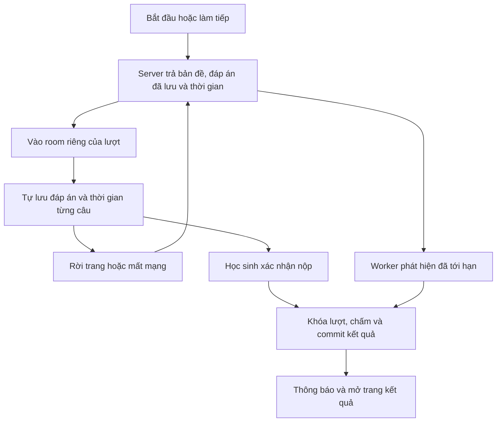

# Kế hoạch triển khai làm bài online

Học sinh có thể rời trang, mở lại cùng lượt làm trên thiết bị khác và tiếp tục từ câu trả lời đã lưu. Đề có thời lượng tự nộp và chấm khi hết giờ, kể cả khi học sinh đã đóng trình duyệt. Đề không giới hạn thời lượng vẫn ghi thời gian hoạt động từng câu. Kết quả là điểm luyện tập theo hướng mở rộng của [đặc tả §4](../../spec.md).

## Bối cảnh và ràng buộc

| Phần | Hiện trạng tại `9ec4028` | Việc cần triển khai |
| --- | --- | --- |
| Trang làm bài và kết quả | `take-exam-page.tsx` lưu nháp theo ID đề trong `localStorage`; `studyApi.submitAttempt` và luồng kết quả dùng mock. Timer hiện chạy ở trình duyệt. | Lưu lượt làm theo tài khoản trên PostgreSQL và đọc kết quả từ backend. Giữ các thao tác điều hướng và đánh dấu câu của trang hiện tại. |
| Tạo đề | `ExamChatUseCase._confirm_and_build` và `LiveExamChat._build` dùng chung phương thức chọn câu. Mẫu có `points_per_question` tùy chọn; đề cá nhân hóa có thể thiếu `points`. Live cập nhật đề khi đổi câu. | Gọi chung một hàm phân bổ sau khi danh sách câu đã được chốt. Lượt đang làm dùng bản đề đã được cố định lúc bắt đầu. |
| Chấm điểm | `frontend/src/features/study/grading.ts` dùng điểm cố định theo loại rồi quy đổi tổng sang thang 10. `QuestionBankRepository.load_items` chủ động loại đáp án và lời giải khỏi đề nháp. | Chấm ở backend với điểm tối đa đã ghi vào đề. Dùng truy vấn nội bộ riêng để nạp khóa chấm. |
| Realtime và tác vụ nền | Đã có Socket.IO với vé xác thực dùng một lần, room theo vai trò và theo người dùng. `app.worker` chạy riêng tiến trình trên production. | Thêm room riêng theo lượt làm và đường truyền từ tác vụ hết giờ đến tiến trình Socket.IO. |

Từ BeeV2, áp dụng cách `CompetitionGateway.subscribeAttempt` kiểm quyền rồi tham gia `competition-submit:<submitId>`, và cách `useCompetitionSocket` đồng bộ đáp án, thời gian khi kết nối lại và đợi xác nhận lưu trước khi nộp. `ExamPracticeAttemptPage` có bộ đếm câu đang làm. Hai điểm cần điều chỉnh cho Examind: use case quét hết hạn của BeeV2 hiện chỉ chuyển trạng thái sang `SUBMITTED`, còn bảng 10/25/50/100 của BeeV2 chỉ áp dụng khi câu Đúng/Sai tối đa 1 điểm. Examind sẽ chấm ngay khi tự nộp và nhân bảng hệ số với điểm tối đa của mọi câu Đúng/Sai hợp lệ.

## Thành phần và trách nhiệm

| Thành phần | Vị trí dự kiến | Trách nhiệm |
| --- | --- | --- |
| Phân bổ điểm | Hàm thuần trong `backend/app/usecase/`, dùng trong `exam_chat.py` và `live_exam_chat.py` | Tính điểm, xác thực tổng đúng 10 và lưu cùng đề sau khi người dùng xác nhận cấu trúc. |
| Nghiệp vụ lượt làm | Use case bắt đầu, đọc, lưu, nộp và chấm trong `backend/app/usecase/`; schema và route học sinh trong `app/schemas/`, `app/api/v1/`; ghép ở `api/deps.py` | Xác thực chủ lượt làm, chốt hạn, kiểm định dạng đáp án, điều phối giao dịch và trả DTO. HTTP, socket và worker dùng cùng nghiệp vụ. |
| Lưu trữ | Model, repository và migration Alembic | Giữ lượt làm, bản đề và khóa chấm nội bộ, đáp án theo câu, thời gian câu, kết quả và sự kiện cần phát. |
| Worker và socket | `backend/app/worker.py`, `backend/app/api/realtime.py` | Worker chấm lượt quá hạn. Tiến trình API phát sự kiện đã commit vào room của lượt làm. |
| Frontend | `frontend/src/features/study/api.ts`, `take/`, `exams/`, `result/` và `features/realtime/realtime-connection.tsx` | Đề xuất **Làm tiếp**, hiển thị trạng thái lưu và thời gian, đồng bộ khi nối lại, hiển thị lý do nộp và điểm do server trả. Tái sử dụng kết nối hiện có của mỗi tab. |

### Dữ liệu và vòng đời

- `exam_attempts` lưu chủ sở hữu, ID đề, phiên bản đề lúc bắt đầu, `started_at`, `deadline_at` nullable, trạng thái `in_progress` hoặc `graded`, phiên bản đồng bộ, vị trí gần nhất, thời điểm nộp và lý do `manual` hoặc `timeout`. Lưu `graded_at` riêng để đo độ trễ của worker. Với bài hết giờ, thời điểm nộp nghiệp vụ là hạn của lượt.
- Giới hạn một lượt `in_progress` trên mỗi cặp học sinh–đề bằng unique index có điều kiện. Nhấn **Bắt đầu** từ hai tab trả về cùng lượt. Sau khi đã chấm, **Làm lại** tạo lượt mới bằng phiên bản đề mới nhất. Việc đổi câu trong chat giữa chừng chỉ ảnh hưởng lượt mới.
- Cố định thứ tự, nội dung, lựa chọn, điểm, và thời lượng đề khi bắt đầu. Khóa chấm, lời giải và phiên bản quy tắc được lưu nội bộ cùng bản đề. Nếu khóa chấm thiếu hoặc dữ liệu câu không hợp lệ, báo lỗi trước khi mở lượt. DTO đang làm bài chỉ chứa nội dung, điểm tối đa và dữ liệu của chính học sinh.
- Đáp án lưu theo cặp lượt–câu, cùng phiên bản câu và ID thao tác đã xử lý. Kết quả lưu điểm và trạng thái từng câu cùng tổng điểm, thời gian từng câu và lý do nộp. Bản ghi đã chấm được đọc lại nguyên vẹn khi tải lại trang.
- Đề cũ thiếu điểm được phân bổ lần đầu khi tạo lượt. Bản nháp mock trên trình duyệt dùng cho chế độ demo. Chế độ thật chỉ khôi phục lượt đã ghi nhận theo tài khoản trên server.

## Luồng dữ liệu và tích hợp

### Bắt đầu, lưu và quay lại

| API dự kiến, dưới `/api/v1` | Hành vi |
| --- | --- |
| `POST /study/exams/{exam_id}/attempts` | Mở hoặc trả lượt đang làm. Nếu lượt cũ đã hết giờ, trả trạng thái/kết quả và cho học sinh chủ động chọn **Làm lại** trước khi tạo lượt mới. |
| `GET /study/attempts/{attempt_id}` | Trả dữ liệu hiện tại gồm `server_now`, `deadline_at`, trạng thái, phiên bản, đáp án, thời gian và vị trí. Đề hoặc danh sách đề trả tóm tắt lượt đang làm để nút **Làm tiếp** mở đúng ID. |
| `PATCH /study/attempts/{attempt_id}/answers/{question_id}` | Lưu khi socket rớt. Dùng cùng payload và luật với `attempt:save`. |
| `POST /study/attempts/{attempt_id}/submit` | Nộp thủ công sau khi đã đồng bộ đáp án. Gửi lại yêu cầu trả cùng kết quả. |
| `GET /study/attempts/{attempt_id}/result` | Trả kết quả đã chấm của chủ lượt cùng dữ liệu cho trang `/results/{attemptId}`. |

1. Dùng vé và kết nối hiện có. `attempt:join` chỉ nhận ID lượt. Server lấy user từ phiên, kiểm quyền sở hữu trước khi vào `attempt:<id>` và trả dữ liệu hiện tại. Frontend đọc phiên bản trên từng sự kiện để bỏ qua dữ liệu cũ. Khi đổi lượt, rời room cũ. Khi reconnect, lấy vé mới, vào lại room, đồng bộ trạng thái trước khi gửi thao tác đang chờ.
2. Cập nhật UI ngay khi nhập. Ghi thao tác chờ vào bộ nhớ bền của trình duyệt theo tài khoản và lượt trước khi gửi. Gửi lựa chọn ngay, gộp thao tác gõ trả lời ngắn trong khoảng 500 ms và gửi khi đổi câu hoặc blur. Hiển thị **Đang lưu**, **Đã lưu** sau xác nhận do server gửi sau commit, hoặc **Mất kết nối · Chưa đồng bộ**. Tải lại cùng thiết bị còn thao tác chờ. Thiết bị khác thấy bản đã được server xác nhận. Sau khi đồng bộ hoặc đăng xuất, dọn dữ liệu cục bộ tương ứng.
3. Mỗi thao tác mang `mutation_id` và `base_revision` của câu. Server kiểm câu thuộc lượt, kiểm payload theo loại và ghi trong giao dịch. Gửi lại cùng ID cho kết quả cũ. Nếu hai tab sửa cùng một câu từ cùng phiên bản, tab gửi sau nhận `409` hoặc lỗi socket tương đương, tải bản hiện tại và cho học sinh chọn áp dụng lại thay đổi của mình. Sửa hai câu khác nhau có thể lưu độc lập. Sau commit, `attempt:answer_saved` cập nhật các tab trong room.
4. Trên nút **Nộp bài**, gửi ngay dữ liệu chờ và đợi xác nhận lưu trước khi nộp. Khi gửi hoặc nhận xác nhận gặp lỗi, giữ bản chờ và cho phép thử lại nếu còn thời gian. Khi quá hạn, chỉ chấm bản đã lưu hợp lệ. Nếu khi hết giờ trình duyệt còn câu chưa đồng bộ, thông báo rõ cùng kết quả.

### Thời lượng, tự nộp và thời gian từng câu

- **Đề có thời lượng**. `deadline_at = started_at + duration_minutes`, tính bằng đồng hồ server và ghi đúng một lần cho lượt. Đề không có ngày đóng chung (`endDate`). Học sinh bắt đầu vào lúc nào cũng được, tiếp tục cùng lượt trong thời lượng còn lại và xem kết quả sau khi hết giờ. Client hiển thị hiệu `deadline_at − server_now` dựa trên mốc đơn điệu của trình duyệt, hiệu chỉnh khi tải, reconnect hoặc tab hiện lại. Rời trang, mất mạng và đổi giờ trên máy không kéo dài lượt.
- **Hết giờ**. UI khóa nhập tại 0 và báo **Hết giờ làm bài. Hệ thống đang chấm bài…**. Worker quét các lượt tới hạn qua index trên `deadline_at` của lượt `in_progress`; đặt chu kỳ riêng, mục tiêu nhận kết quả trong 5 giây sau hạn ở tải demo. API mở lại lượt quá hạn cũng gọi cùng nghiệp vụ hoàn tất nếu worker chưa xử lý. Nộp tay, autosave và worker khóa cùng dòng lượt trong giao dịch. Sau khi lấy khóa, so sánh bằng thời điểm thực trên server hoặc PostgreSQL `clock_timestamp()`; từ `now >= deadline_at`, mọi ghi đáp án mới bị từ chối. Chấm, lưu kết quả và đánh dấu `graded` cùng giao dịch. Worker có thể thử lại sau lỗi khởi động hoặc gián đoạn. Yêu cầu lặp chỉ đọc lại kết quả.
- **Thông báo hết giờ**. Trong giao dịch hoàn tất, ghi một sự kiện `attempt:finished` kèm `reason`, phiên bản và ID kết quả vào bảng outbox PostgreSQL. Tiến trình API đọc outbox và phát vào room sau commit, kể cả khi worker chạy riêng. Phía nhận loại trùng theo ID sự kiện. Nếu bỏ lỡ sự kiện hoặc mở lại sau đó, `GET` trả lý do `timeout`. UI hiển thị **Hết giờ làm bài. Bài đã được tự động nộp và chấm.** cùng lối mở kết quả.
- **Đề vô hạn**. `deadline_at = null`, UI hiện **Không giới hạn**. Lượt chỉ chấm sau khi học sinh nộp. Khi quay lại có thể tiếp tục cùng lượt dù đã qua nhiều ngày.
- **Thời gian từng câu**. Cho cả hai chế độ, đo trên câu đang hiển thị ở tab đang hoạt động bằng thời gian đơn điệu. Chốt đoạn đo khi đổi câu, tab ẩn, rời trang hoặc nộp và gửi checkpoint định kỳ khi vẫn mở câu. Gửi thời gian độc lập với đáp án để câu chưa trả lời vẫn có thống kê. Mỗi đoạn có ID riêng để retry không cộng hai lần. Server chỉ ghi từ tab đang giữ quyền đo của lượt, dùng heartbeat có hạn để tab khác tiếp quản nếu tab cũ mất kết nối, và cắt thời lượng tại hạn nộp. Cộng dồn khi học sinh quay lại cùng câu. Thời gian giữa các phiên nghỉ và thời gian tab ẩn không được cộng. Trang kết quả dùng tổng thời gian từng câu để hiển thị nhịp độ.

### Điểm lúc tạo đề và điểm lúc nộp

**Phân bổ trước khi lưu đề.** Sau khi người dùng xác nhận cấu trúc hoặc chấp nhận số câu thực tế trong đề thiếu câu, đếm câu có mặt theo `SINGLE_CHOICE`, `TRUE_FALSE`, `SHORT_ANSWER`. Backend áp dụng bảng điểm mẫu và trọng số theo loại. Model chỉ đề xuất cấu trúc. Không tạo đề rỗng hoặc đề có loại câu chưa hỗ trợ chấm tự động. Tính điểm trước thao tác trừ credit và lưu đề, trong cùng luồng xác nhận hiện có.

| Dữ liệu điểm | Cách phân bổ đề xuất |
| --- | --- |
| Đề không có điểm sẵn | Dùng phân bổ theo loại đã xác nhận, mặc định `30/40/30`. Tổng điểm mỗi nhóm = `10 × trọng số nhóm / tổng trọng số của các nhóm có câu`. Sau đó chia đều điểm nhóm cho số câu thuộc nhóm. Ví dụ 12 trắc nghiệm, 4 Đúng/Sai, 6 TLN cho từng nhóm lần lượt 3, 4, 3 điểm, tương ứng `0,25`, `1`, `0,5` mỗi câu. |
| Mẫu đủ điểm, tổng 10 | Giữ nguyên `points_per_question` theo phần và ghi vào từng câu đã chọn. |
| Mẫu đủ điểm, tổng dương khác 10 | Giữ giá trị gốc của mẫu trong metadata. Ghi điểm đã chuẩn hóa cho mỗi câu bằng `điểm gốc × 10 / tổng gốc`, để giữ tỷ lệ của mẫu. Quy tắc này cũng áp dụng khi người dùng đã chấp nhận mẫu rút gọn vì thiếu câu. |
| Mẫu có phần thiếu điểm | Ưu tiên giữ mỗi điểm đã khai báo. Phân phần còn lại (`10 − tổng điểm đã khai báo`) theo trọng số của những loại có câu thiếu điểm, rồi chia đều trong từng loại. Nếu phần còn lại không dương, báo lỗi cấu trúc để chỉnh trước khi lưu. |

Nếu loại câu vắng mặt, chỉ tính trọng số của các loại có câu. Ví dụ đề chỉ có trắc nghiệm và TLN thì chia 5/5 theo trọng số 30/30. Trọng số phải dương cho mỗi loại cần thuật toán cấp điểm. Dùng số hữu tỉ chính xác trong phân bổ và tính tổng để các câu cùng nhóm được chia đều ngay cả với `3/7` điểm mỗi câu. Lưu điểm hữu tỉ và phiên bản quy tắc trong dữ liệu nội bộ. Dùng trường `items[].points` hiện có để trả giá trị hiển thị tương thích và bổ sung `max_score = 10`. UI làm tròn khi trình bày, tổng lấy từ giá trị chính xác. Khi đổi câu cùng loại/điểm theo mẫu, điểm theo vị trí được giữ. Khi cơ cấu đổi, chạy lại phân bổ cho phiên bản đề mới.

**Chấm khi nộp.** Backend so đáp án của học sinh với khóa chấm đã cố định khi bắt đầu. Điểm tối đa toàn đề luôn bằng 10, làm đúng hết được 10 và bỏ trống hết được 0. Tổng điểm hiển thị làm tròn đến hai chữ số thập phân sau khi cộng điểm chính xác.

| Dạng câu | Cách chấm |
| --- | --- |
| Trắc nghiệm một lựa chọn | Chọn đúng ID phương án được đủ điểm của câu. Sai hoặc bỏ trống được 0. |
| Đúng/Sai | Mỗi câu có đúng bốn mệnh đề. Lưu từng giá trị `true`, `false` hoặc `null` theo ID mệnh đề. `null` là bỏ trống và không tính đúng. Đúng 0/1/2/3/4 mệnh đề lần lượt nhận 0%/10%/25%/50%/100% điểm tối đa của câu. Ví dụ câu tối đa 0,80 điểm, đúng 3 mệnh đề được 0,40. |
| Trả lời ngắn (TLN) | Đủ điểm khi khớp đáp án được duyệt. Với đáp án số, chuẩn hóa dấu thập phân Việt Nam, dấu âm và khoảng trắng ở hai đầu, rồi so sánh giá trị thập phân chính xác. Với đáp án chuỗi đã duyệt, dùng quy tắc so khớp sau chuẩn hóa khoảng trắng đã định nghĩa cho đề. Sai, rỗng hoặc sai định dạng được 0. |

## Quyết định và cách kiểm chứng

### Thứ tự triển khai

1. **Phân bổ điểm trong luồng tạo đề.** Thêm hàm thuần, DTO và kiểm thử đề theo mẫu, đề theo loại, đề thiếu câu và đổi câu. Nghiệm thu khi backend tạo và trả đủ điểm trước khi mở lượt, và chat hiện tại vẫn dùng được.
2. **Lưu lượt và chấm qua HTTP.** Thêm migration, quyền truy cập, khóa chấm nội bộ, lưu đáp án và nộp tay. Nghiệm thu khi cùng tài khoản mở hai trình duyệt đều khôi phục đúng lượt, và kết quả vẫn ổn định sau khi đổi phiên bản đề.
3. **Nộp hết giờ và realtime.** Thêm room, outbox, job vào `app.worker`, thời gian server và xử lý khi kết nối lại. Nghiệm thu khi đóng tất cả tab mà bài có giờ vẫn tự chấm. Bài vô hạn vẫn tiếp tục được sau nhiều ngày.
4. **Nối trang học sinh và đo thời gian câu.** Nối danh sách đề, nút Làm tiếp, màn hình làm bài và kết quả. Hoàn thiện hàng đợi cục bộ, xung đột giữa tab, trạng thái hết giờ và thống kê nhịp độ. Bật luồng thật sau khi migration và worker cùng chạy trên môi trường thử.

### Các kịch bản nghiệm thu

| Kịch bản | Kỳ vọng |
| --- | --- |
| Đề có giờ, đã lưu câu, tắt trình duyệt rồi mở bằng thiết bị khác | Cùng ID lượt, câu đã lưu còn nguyên, thời gian đã trôi được trừ. |
| Đề có giờ, đóng hết tab cho tới sau hạn hoặc khởi động lại backend/worker | Tự thấy kết quả và thông báo hết giờ khi quay lại. Lượt chỉ có một kết quả, theo đáp án đã lưu trước hạn. |
| Gửi đáp án đúng tại hạn, nộp tay cùng lúc với worker | Ghi đáp án từ đúng hạn trở đi bị từ chối; chỉ một đường hoàn tất thắng và lần đọc lại trả cùng kết quả. |
| Mất mạng khi nhập, reload rồi reconnect; mất một ACK | Bản chờ còn trên cùng thiết bị. Nếu còn giờ, thao tác gửi lại được xử lý một lần. Nếu đã hết giờ, UI báo phần chưa đồng bộ. |
| Hai tab sửa cùng câu, lúc đầu chưa có câu trả lời nào | Mỗi câu có một phiên bản, cập nhật cũ không ghi đè. Khi một tab chấm xong, tab còn lại dừng nhập. |
| Người khác dò ID lượt, yêu cầu vào room hoặc lấy kết quả | HTTP và socket đều từ chối; dữ liệu đang làm không có đáp án đúng, kể cả khi tự xem response. |
| Đề vô hạn, chuyển câu, ẩn tab, mở lại cùng câu rồi nộp | Không tự nộp, không hiện đồng hồ toàn bài, thời gian của các đoạn hoạt động cộng đúng câu và retry không cộng trùng. |
| Đủ, thiếu hoặc không có điểm mẫu; số câu lẻ; chỉ còn một loại | Khi cấu trúc hợp lệ, tổng chính xác bằng 10. Câu cùng nhóm fallback có cùng điểm. Mẫu đủ 10 giữ nguyên điểm. |
| Đúng/Sai tối đa khác 1; có mệnh đề bỏ trống; TLN dùng `,` hoặc `.` | Đúng/Sai nhận đúng 5 bậc hệ số. Bỏ trống không tính đúng. TLN tương đương về số cho cùng điểm. |
| Đổi câu trong chat hoặc sửa ngân hàng sau khi đã bắt đầu | Đề và khóa chấm của lượt cũ vẫn theo bản lúc bắt đầu. Lượt mới dùng bản hiện hành. |

Khi có code, chạy `pytest -q` trong `backend/` và `npm run typecheck` trong `frontend/`. Kiểm tra giao dịch đồng thời và tiến trình riêng trên PostgreSQL trong local stack, sau đó chạy các kịch bản trên bằng hai phiên trình duyệt. Theo dõi số lượt chưa chấm đã quá hạn, độ trễ chấm và sự kiện chờ phát. Kiểm tra riêng bản chạy thử của hackathon bằng `python run.py check` từ gốc repo; tiêu chí sản phẩm của bảng trên phục vụ luồng online.

## Tài liệu liên quan

- [API tạo đề ôn](../api/user-exam-api.md) và [API mẫu cấu trúc đề](../api/exam-templates-api.md).
- [Trang học sinh frontend](frontend-student-pages.md), [các lớp backend](backend-layers.md) và [API realtime](../api/realtime-api.md).
- [Chạy local stack và worker](../operations/run-local-stack.md#chạy-worker-học-sinh) và [runbook EC2](../operations/deploy-ec2.md).
