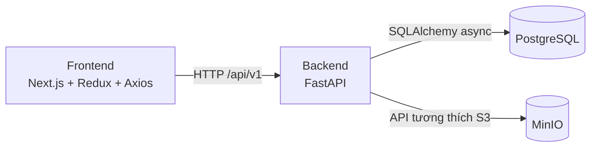

# Tổng quan kiến trúc

**Mục đích:** mô tả các thành phần của bộ khung và cách chúng nối với nhau · **Người phụ trách:** Nguyễn Minh Đức · **Issue:** #1 · **Cập nhật:** 2026-11-27

Bộ khung dừng ở kết nối mẫu. Schema nghiệp vụ, migration nghiệp vụ và API nghiệp vụ thuộc các issue tính năng (#3, #4, #5).

| Thành phần | Công nghệ | Vai trò |
|---|---|---|
| Backend | Python 3.12, FastAPI, SQLAlchemy 2.0 async, Alembic | API, luồng nghiệp vụ, truy cập dữ liệu |
| Frontend | Next.js, TypeScript, Tailwind, Redux Toolkit, Axios | Giao diện *(làm sau, chưa có trong nhánh này)* |
| Cơ sở dữ liệu | PostgreSQL 16 | Dữ liệu có cấu trúc |
| Lưu trữ tệp | MinIO | PDF gốc, ảnh câu hỏi |
| Khung hackathon | `codebase/`, `run.py`, `eval/`, `cost/` | Chỉ dùng thư viện chuẩn Python, **không sửa** theo `AGENTS.md`. Backend sẽ gọi `codebase/agent.py` ở issue #4 |

## Hạ tầng local

`docker-compose.yml` ở thư mục gốc chạy `postgres`, `minio` và hai container init chạy một lần rồi thoát:

- `db-init`: chạy `alembic upgrade head`.
- `minio-init`: tạo bucket nếu chưa có.

Backend và frontend chạy trực tiếp trên máy. Xem [guides/local-setup.md](../guides/local-setup.md).

## Nơi đặt code của các issue sau

Xem mục "Thêm tính năng mới" trong [backend.md](backend.md).
