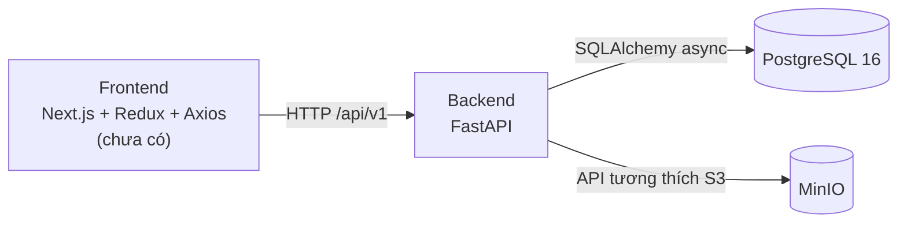

# Tổng quan hệ thống

Dành cho thành viên mới cần biết các thành phần của bộ khung và cách chúng nối với nhau. Phạm vi là bộ khung của issue #1: kết nối mẫu giữa backend, PostgreSQL và MinIO. Frontend được thêm ở phần sau của issue này.

## Bối cảnh và ràng buộc

- Issue #1 yêu cầu bộ khung chạy local. Schema, migration và API nghiệp vụ thuộc các issue #3, #4, #5.
- Khung hackathon (`codebase/`, `run.py`, `eval/`, `cost/`) chỉ dùng thư viện chuẩn Python và không sửa theo [AGENTS.md](../../AGENTS.md). Backend chạy riêng trong `backend/` và sẽ gọi `codebase/agent.py` ở issue #4.
- Đặc tả sản phẩm: [spec.md](../../spec.md) §4.

## Thành phần và trách nhiệm

| Thành phần | Công nghệ | Vai trò |
| --- | --- | --- |
| Backend | Python 3.12, FastAPI, SQLAlchemy 2.0 async, Alembic | API, luồng nghiệp vụ, truy cập dữ liệu. Chi tiết: [backend-layers.md](backend-layers.md) |
| Frontend | Next.js, TypeScript, Tailwind, Redux Toolkit, Axios | Giao diện *(chưa có)* |
| PostgreSQL | 16 | Dữ liệu có cấu trúc |
| MinIO | `bitnamilegacy/minio` 2025.5.24 | PDF gốc, ảnh câu hỏi |

## Luồng dữ liệu và tích hợp

`docker-compose.yml` ở thư mục gốc chạy `postgres`, `minio` và hai container init chạy một lần rồi thoát:

- `db-init`: dùng image backend, chạy `alembic upgrade head`.
- `minio-init`: tạo bucket nếu chưa có (`mc mb --ignore-existing`).

Backend và frontend chạy trực tiếp trên máy ở giai đoạn này. Backend đọc cấu hình từ `backend/.env`.

### Xác thực (issue #8)

- Hai vai trò `student` và `admin`. Đăng ký công khai chỉ tạo `student`. `admin` tạo bằng lệnh `python -m app.cli.create_admin` chạy trên máy chủ.
- Phiên là token opaque nằm trong cookie `examind_session` (HttpOnly, SameSite=Lax). PostgreSQL chỉ lưu SHA-256 của token (bảng `sessions`, migration `0003_auth`). Đăng xuất hoặc khoá tài khoản có hiệu lực ngay.
- Frontend gọi backend qua rewrites `/api/*` của Next.js nên cùng origin: cookie đi kèm tự động, không cần CORS. `CORS_ORIGINS` mặc định rỗng, chỉ đặt khi dev gọi thẳng backend.
- Endpoint kiểm quyền bằng dependency trong `app/api/deps.py`. Chi tiết: [backend-auth.md](backend-auth.md), hợp đồng HTTP: [auth-api.md](../api/auth-api.md).

### Trên VPS

`docker-compose.prod.yml` thêm `backend` và `nginx`. Chỉ nginx mở cổng 80; backend, PostgreSQL và MinIO chỉ nghe trên `127.0.0.1` hoặc mạng nội bộ Compose. GitHub Actions deploy mỗi lần merge vào `main` ([deploy-backend-ci-cd.md](../operations/deploy-backend-ci-cd.md)). Dữ liệu nền nạp một lần từ gói đã lọc ([seed-base-data.md](../operations/seed-base-data.md)).

## Quyết định và cách kiểm chứng

| Quyết định | Lý do |
| --- | --- |
| Code mới ở `backend/` và `frontend/`, không đặt trong `codebase/` | Giữ khung hackathon độc lập; issue #4 vẫn cần `answer(text)` và `python run.py` |
| Dùng `bitnamilegacy/minio` | `minio/minio` đã bị gỡ khỏi Docker Hub và quay.io trả 401 khi chưa đăng nhập (kiểm ngày 2026-11-27). Đổi khi nhóm chốt nguồn khác |
| Container init chạy một lần, idempotent | Lần chạy sau không tạo trùng bảng hoặc bucket |

Kiểm chứng: làm theo [run-local-stack.md](../operations/run-local-stack.md).

## Tài liệu liên quan

- [Các lớp backend](backend-layers.md)
- [Xác thực và phân quyền backend](backend-auth.md)
- [Chạy bộ khung local](../operations/run-local-stack.md)
- [API mẫu](../api/sample-api.md)
